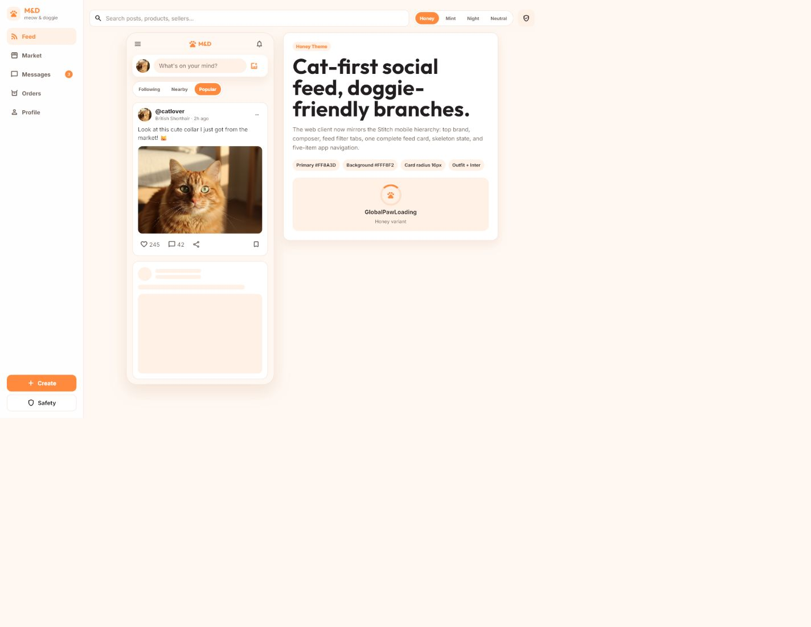
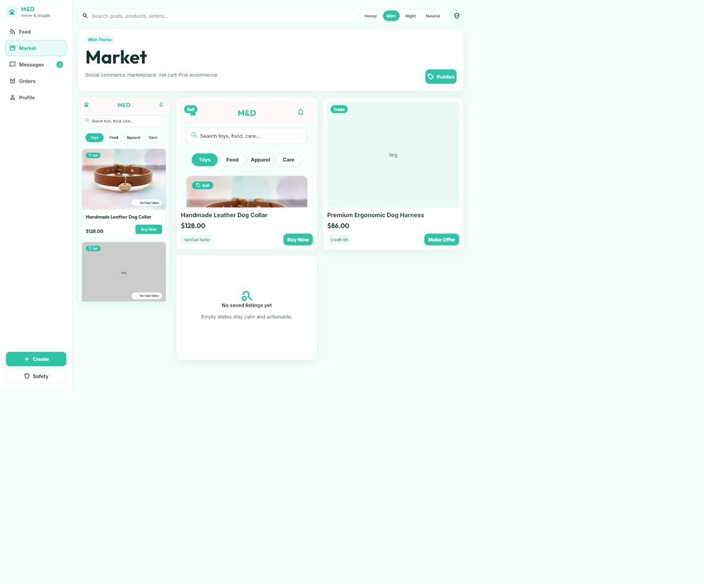
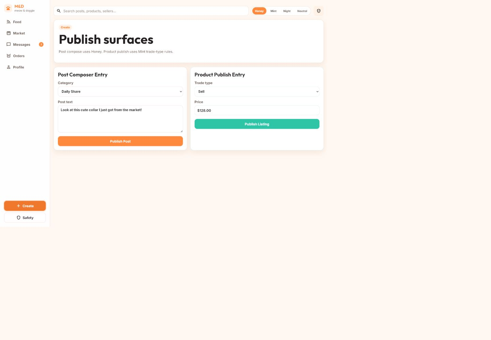
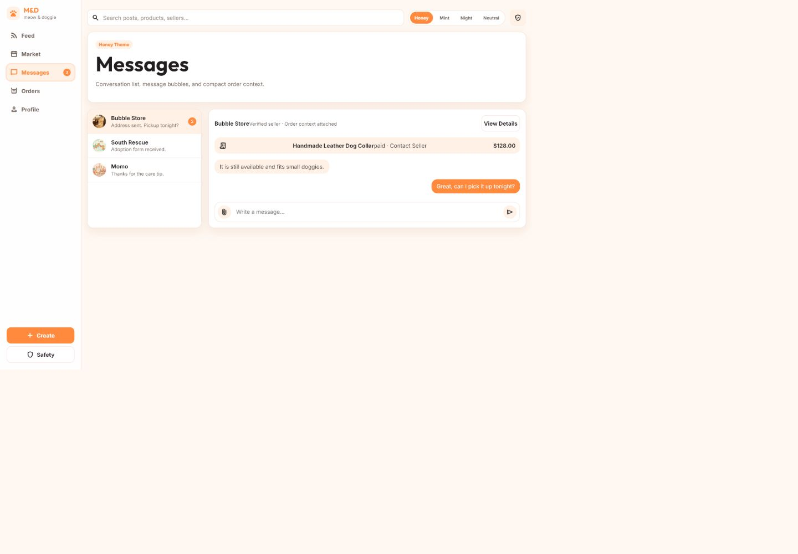
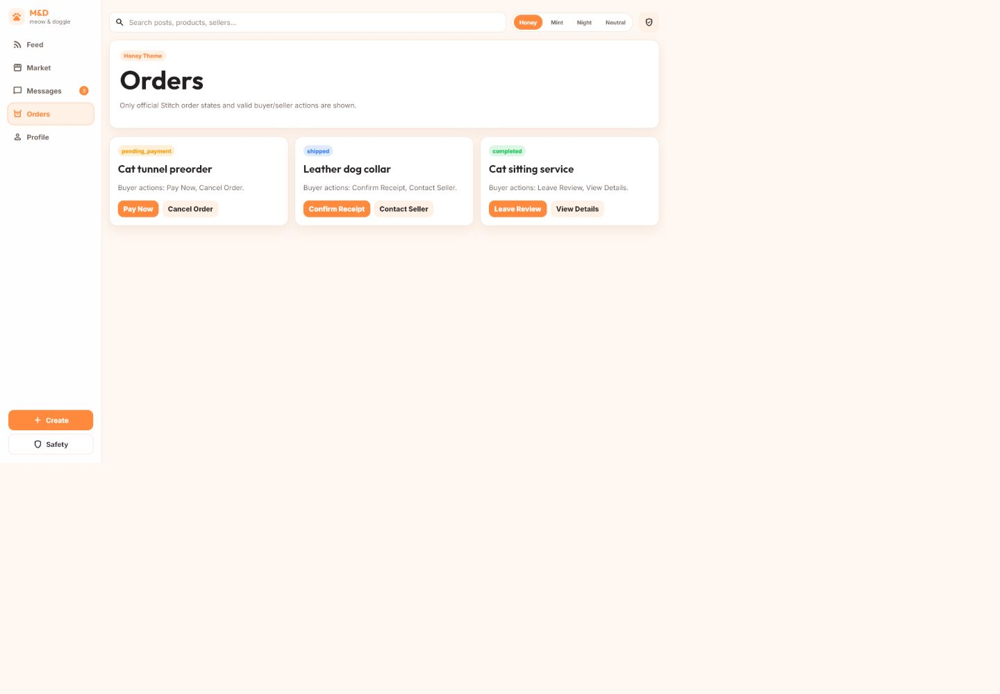
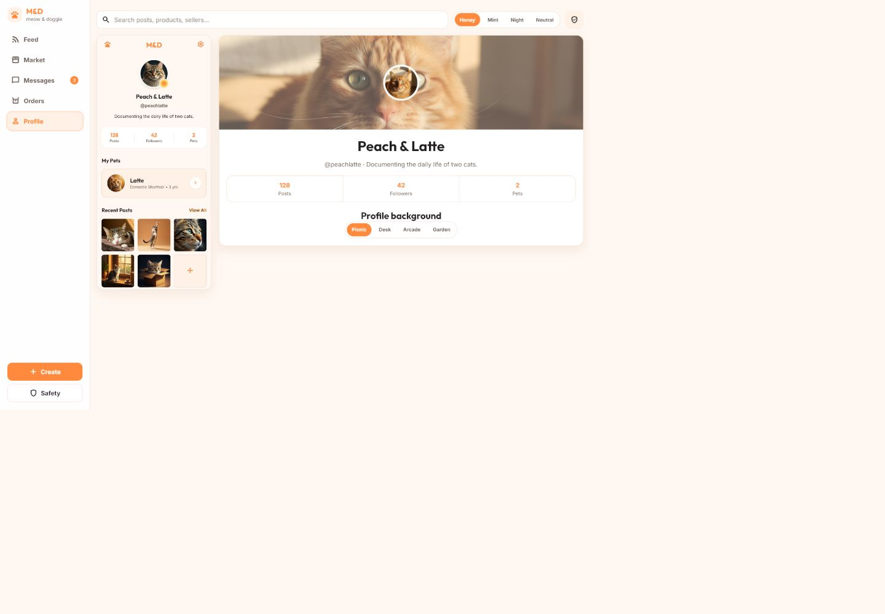
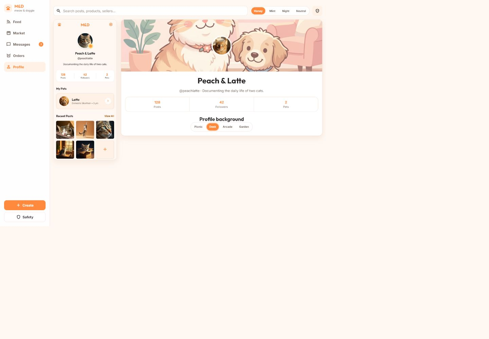
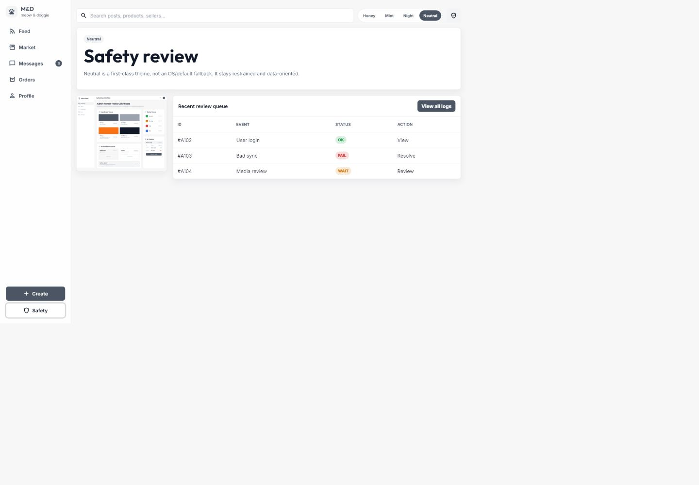
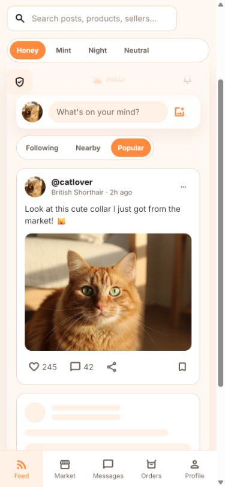
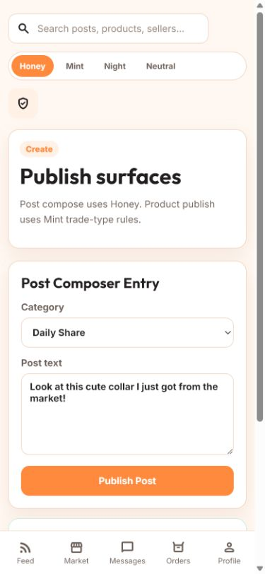

# M&D 2026-08 产品设计与 UX / 无障碍历史审计

> **适用范围更新：2026-10-15。** 下文保留 2026-08-30 至 08-31 的代码与截图证据，未重新运行或渲染。其交易/订单主线、导航及发布优先级不再代表当前产品范围。现行需求见 [PRD 2.0](../bmad/prd.md)、[UX 规格](../bmad/ux-design.md)和[真实性规范](MND_TRUST_AND_DISCLOSURE_SPEC.md)；整体逻辑见[七张流程图](flows/index.html)。视觉 token 与有证据的无障碍发现仍可供后续修复参考。

| 文档属性 | 内容 |
| --- | --- |
| 产品 | M&D (`meow & doggie`) |
| 文档版本 | 1.0 |
| 状态 | 历史证据；非当前实施规格 |
| 更新日期 | 2026-08-31 |
| 审计证据周期 | 2026-08-30 至 2026-08-31 |
| 设计权威 | Stitch V2 项目 `projects/13275961100622290348` |
| 核心目标 | 用代码事实定义当前产品体验，识别 UX、视觉与无障碍风险，并给出可验收的统一设计规范 |

> 本文以当前代码为主证据，以本次浏览器审计截图为渲染证据。`web/cute.html` 是静态 WebUI 视觉原型，不等同于完整生产流程；生产 Web、Expo、KMP 与后台工作台的实际能力会单独标注。

## 1. 执行摘要

M&D 已经形成清晰、可延展的产品方向：品牌保持 `M&D / meow & doggie`，猫是情感主角，doggie 是活动、服务、领养和交易中的友好分支；Honey、Mint、Night、Neutral 四主题、Outfit + Inter 字体体系、16px 消费卡片和五项核心导航也已经在多端代码中建立。

当前主要问题不是缺少视觉风格，而是体验真相分裂：

1. `web/cute.html` 能展示 Feed、Market、Messages、Orders、Profile、Create 和 Safety，但 `web/cute-ui.js` 只实现页面切换、主题切换和个人主页背景切换；多数主操作没有提交、加载、成功或失败反馈。
2. 生产 Web 已经具备登录校验、草稿、媒体上传、发帖、交易、消息、订单和本地演示回退，但各页面的完成度和默认数据模式不一致。
3. `web/dashboard.js` 的订单动作与 Stitch 设计契约存在高风险差异：卖家在 `paid` 和 `shipped` 状态可触发 `refund`，而当前设计契约没有把它列为对应角色的可见动作。
4. 主题 token 中 Honey / Mint 的白字主按钮对比度不足，属于设计系统级无障碍风险，而不是单页修饰问题。
5. Consumer WebUI 把 Safety 审核队列放进普通用户侧导航，产品角色、权限边界和信息架构不够清楚。

总体判断：**品牌与设计系统基础良好，Profile 个性化最接近完整体验；核心消费闭环仍处于“可展示、未完全可用”阶段。发布、交易、消息和订单动作应先完成闭环，再继续扩大页面数量。**

## 2. 审计范围与证据

### 2.1 本次审计范围

- 核心消费路径：Feed → Market → Create → Messages → Orders → Profile。
- 交叉能力：搜索、主题切换、个人背景切换、Safety 入口。
- 响应式检查：390 × 844 移动视口的 Feed 与 Create。
- 代码检查：WebUI 原型、生产 Web、登录/注册、发帖、市场、消息、订单工作台、共享主题与多语言基础。
- 设计依据：`.stitch/DESIGN.md`、`MND_UI_ALIGNMENT_GUIDE.md`、`MND_STITCH_AI_RULES.md`。

### 2.2 未包含

- 未启动 Go、Gradle、Expo、KMP 或真实业务服务。
- 未执行登录、支付、退款、发货等真实服务端流程。
- 未使用屏幕阅读器、Windows 高对比模式或系统级 200%/400% 缩放。
- 未声称达到完整 WCAG 合规；本文只报告代码和截图能够支持的风险。

## 3. 产品定义

### 3.1 品牌定位

- 可见品牌：`M&D`。
- 品牌锁定语：`meow & doggie`。
- 猫优先：Auth、Feed、Profile、默认情绪表达和默认图像由猫主导。
- Doggie 友好：Market、服务、活动、领养和次级故事允许 doggie 内容。
- 产品气质：可爱、精致、适合青少年和年轻人，但不幼稚。

### 3.2 核心用户

| 用户 | 核心任务 | 设计重点 |
| --- | --- | --- |
| 社区浏览者 | 发现宠物内容、关注、互动 | 快速理解 Feed、明确内容层级、低门槛互动 |
| 内容创作者 | 发布日常、求助、活动 | 草稿、媒体、校验、失败恢复、发布确认 |
| 买家 / 交换者 | 找好物、联系卖家、下单 | 信任信息、交易类型、价格、动作与订单状态一致 |
| 卖家 / 服务者 | 发布商品、处理订单、沟通 | 状态约束、角色动作、发货与退款保护 |
| 宠物身份经营者 | 管理资料、宠物、背景、主题 | 身份表达、个性化持久化、隐私与账号入口 |
| 审核 / 运营角色 | 处理举报、媒体和审计记录 | 独立工作台、权限隔离、操作留痕 |

## 4. 当时建议信息架构（已被新产品方案替代）

当时审计覆盖 Feed、Create、Market、Messages、Orders、Profile 和独立 Safety/Admin；保留以下描述用于理解历史页面。当前业务关系与异常路径改见[独立流程图](flows/index.html)，不依据本节安排新版本开发。

### 4.1 Consumer 主导航

当时对应 Stitch 参考的五项为：

1. Feed
2. Market
3. Messages
4. Orders
5. Profile

Create 是上下文动作：Feed composer、Market Publish、桌面侧栏主按钮；不额外挤入移动端五项主导航。

### 4.2 跨页面能力

- 搜索：需要有明确作用域，并在 Feed / Market 中给出不同提示。
- 通知：从全局头部进入，不能只展示图标而没有响应。
- 主题：属于全局用户偏好，Consumer 页面切换不应强制重置。
- Safety：属于权限受控工作台，不应与普通用户主导航并列。

## 5. 当前实现真相

| 表面 | 当前代码事实 | 设计使用方式 |
| --- | --- | --- |
| `web/cute.html` | 静态 WebUI 原型；完整展示主要页面 | 视觉与布局评审，不可作为完整功能验收 |
| `web/cute-ui.js` | 仅实现 view、theme、profile background；用 hash 记录当前 view | 证明导航和个性化基础，不证明业务动作已完成 |
| `web/index.html` + `web/app.js` | Feed、搜索、筛选、点赞、登录跳转、演示 Feed 回退 | Consumer Web 实际交互基础 |
| `web/compose.html` + `web/compose.js` | 登录保护、本地草稿、媒体上传、POST 发帖、成功后跳详情 | 发帖真实流程来源 |
| `web/market.html` + `web/market.js` | 商品筛选、创建订单、Toast；默认不是 `?live` 时使用回退数据 | 市场演示可用，但必须明确 Demo / Live 状态 |
| `web/messages.html` + `web/messages.js` | 会话加载、演示回退、发送消息 | 消息真实流程来源 |
| `web/profile.html` + `web/profile.js` | 分享、编辑、背景持久化、API / Demo 回退 | Profile 实际交互基础 |
| `web/dashboard.html` + `web/dashboard.js` | 发帖、上架、草稿、订单、消息和媒体工作台 | Creator / Seller 工作台，不应代替 Consumer 页面 |
| `web/admin.html` | 审核与系统控制 | 仅管理员角色使用 |
| Expo / KMP | 四主题、组件、Screen 与 API 模型均已存在 | 作为多端一致性实现来源，需单独运行验证 |

## 6. 流程审计

### Step 1 — Feed：基础健康，互动闭环不足

健康度：**Needs work**

优势：

- 猫优先内容、品牌、composer、Feed tabs、完整卡片和 skeleton 均可见。
- 五项导航与 Stitch V2 产品合同一致。
- Feed 的情绪中心和 Market 的连接文案清晰。

风险：

- `cute-ui.js` 没有 Feed tabs、点赞、评论、分享、收藏和通知处理器；这些按钮仅可见。
- skeleton 与已加载卡片同时永久出现，运行时语义更像“仍在加载”，不适合作为真实 Feed 状态。
- `role="tablist"` 的子按钮没有 `role="tab"` / `aria-selected`。
- Like 没有 `aria-pressed`；share / bookmark 依赖图标字体文本形成名称，没有显式 `aria-label`。
- Search 在 WebUI 原型中没有过滤或结果反馈。

设计要求：

- Runtime 中 loading、loaded、empty、error 必须互斥。
- Like / Save 使用 optimistic UI，并在失败时回滚并播报。
- Feed tabs 支持键盘左右移动、selected 状态和 URL 状态。
- 搜索提交后必须显示作用域、结果数、无结果建议和清除入口。

### Step 2 — Market：结构清楚，信任与素材状态不完整

健康度：**Needs work**

优势：

- Sell / Trade 类型和 Buy Now / Make Offer 动作符合社交交易方向。
- Mint 视觉保持清洁、轻量，Verified Seller 和 Credit 信息提供初步信任信号。
- Empty state 可见。

风险：

- 第二张商品卡直接使用文本 `img` 作为占位，属于破损素材状态。
- `web/market.js` 默认使用 `FALLBACK_LISTINGS`，只有 `?live` 才请求 API；用户无法从界面判断当前是演示数据还是实时数据。
- WebUI 原型中的 Buy Now / Make Offer / Publish 没有动作反馈。
- 当前列表缺少位置、运费/交付方式、发布时间、商品状态和举报入口。
- Market 导航会被 `viewThemes` 强制切到 Mint，和“全局主题由用户选择”的实现合同冲突。

设计要求：

- 真实图片失败时显示品牌化媒体 fallback、替代文本和重试，禁止显示 `img` 文本。
- 明确 Demo / Offline / Live 数据状态，不能把演示数据伪装成在线结果。
- 商品卡至少包含：交易类型、标题、价格/面议、卖家信任、位置或交付方式、主要动作。
- Buy Now 进入确认流程；Make Offer / Contact Seller 进入对应会话并携带 listing context。

### Step 3 — Create：视觉可读，原型没有完成发布

健康度：**Blocked in prototype / implemented separately in production Web**

优势：

- Post 与 Listing 的任务分区清楚。
- Trade type 使用 Sell、Trade、Looking For、Free / Donation 的官方枚举。
- 生产 `web/compose.js` 已有登录保护、草稿、媒体上传、提交和成功跳转。

风险：

- WebUI 的 Publish Post / Publish Listing 是 `type="button"`，没有监听器；点击后没有状态变化。
- 同一页面把 Honey Post 和 Mint Listing 局部混色，违反“一屏一个主题”和全局主题继承原则。
- 原型 Post 缺标题、媒体、草稿、字段校验和字数说明；Listing 仅有交易类型和价格。
- 缺少 loading、success、retry、duplicate-submit protection。

设计要求：

- 第一步先选择 `Post` 或 `Listing`，再进入单一任务、单一主题的表单。
- Post 至少包含 mode、title、body、media、tags、draft 状态。
- Listing 至少包含 type、title、description、price/currency、media、交付方式、位置和预览。
- 提交按钮在 pending 时禁用并显示 `GlobalPawLoading`；成功有明确确认和下一步，失败保留用户输入。

### Step 4 — Messages：交易上下文有价值，但会话结构不可操作

健康度：**Needs work**

优势：

- 会话列表、消息气泡、未读数量、输入区和订单上下文都在同一工作面内。
- 交易聊天能看到商品和金额，降低记忆负担。
- 生产 `web/messages.js` 已实现演示会话和 `/api/v1/messages` 发送。

风险：

- WebUI 会话项使用 `<article>`，不是 button / link，键盘和语义上不可切换。
- 当前渲染中 `Bubble StoreVerified seller`、商品名与 `paid` 状态发生粘连，信息组缺少结构化间距。
- 消息列表缺时间、发送状态、失败重试和已读状态。
- WebUI Send 是 `type="button"`，表单没有实际 submit 行为。
- Attach / Send 为 36 × 36px，满足 WCAG 2.2 的 24px 最低目标，但低于本项目建议的 44px 触控尺寸。

设计要求：

- 会话项使用可聚焦 button / link，并暴露 selected / unread 状态。
- Message 必须有 sending、sent、failed、retry、read 的状态模型。
- 订单上下文块使用清晰的 title / status / action / price 列，不拼接文本。
- 输入区支持 Enter 发送、Shift+Enter 换行，并说明附件类型和大小限制。

### Step 5 — Orders：状态模型正确，生产动作矩阵存在高风险差异

健康度：**At risk**

优势：

- 原型使用 `pending_payment`、`shipped`、`completed` 官方状态。
- 示例 Buyer actions 与 Stitch 规则大体一致。
- 生产工作台有 buyer / seller 切换、筛选、统计、CSV 和 API 动作。

风险：

- 原型直接向用户显示 `pending_payment`，没有本地化为“待支付”。
- 卡片缺订单号、卖家/买家、金额、日期、商品缩略图和状态时间线。
- `web/dashboard.js` 中卖家在 `paid` 与 `shipped` 状态可看到 `refund`，但 Stitch 当前动作表没有定义这两个入口；这是财务动作，必须先确认业务权限。
- 动作提交后只有重载或错误 Toast，缺少进行中和成功确认；可能重复点击。

设计要求：

- 订单状态显示本地化标签，原始枚举只用于代码和数据属性。
- 所有财务/不可逆动作使用二次确认，显示对象、金额、后果和当前状态。
- 订单动作必须由统一状态机产生，Web、Expo、KMP、API 使用同一规则来源。
- Seller / Buyer 的联系人和物流动作需补齐，不允许各端自行解释状态。

### Step 6 — Profile：当前最成熟的消费页面

健康度：**Good foundation**

优势：

- 猫优先身份、封面、头像、简介、统计和宠物内容层级清楚。
- Desktop + mobile reference 的映射直观。
- 背景切换有 `aria-pressed`，并在 `localStorage` 持久化。

风险：

- WebUI 只展示背景切换，缺 Edit、Settings、Privacy、Theme、Logout 等 Profile hub 入口。
- 统计值看起来可点击，但没有明确交互语义。
- 封面图片需要验证文字/头像在所有背景上的对比度和裁切。

设计要求：

- Profile 主屏保持身份优先；设置和 Logout 下沉到次级页面。
- Posts / Followers / Pets 若可点击，应使用链接/按钮和明确标签。
- 所有背景需要提供安全焦点区、头像可读区和浅/深主题遮罩规则。

### Step 7 — Profile 个性化：交互反馈健康

健康度：**Healthy**

- Desk 选项点击后视觉背景立即变化，按钮更新为 pressed。
- 设置通过 `mnd_profile_bg` 持久化。
- 这是当前原型中“动作—状态—视觉反馈”最完整的示例，应作为其他交互的实现基准。

### Step 8 — Safety：视觉正确，角色边界错误

健康度：**Role / IA risk**

优势：

- Neutral 主题、8px 卡片和数据表方向符合后台工作台。
- 表格具有正确的 table / row / header 结构。

风险：

- Safety 与 Consumer Create 并列在侧栏底部，顶部也有快捷入口；普通用户会误以为可访问审核队列和日志。
- Action 列中的 View / Resolve / Review 是纯文本，不是可聚焦控件。
- 缺少角色、权限、敏感操作确认和审计反馈。

设计要求：

- 从 Consumer shell 移除 Safety 管理入口；举报入口保留在内容/交易上下文中。
- Safety 仅出现在授权后的 Admin shell，并明确当前角色。
- Review / Resolve 使用 button / link；不可逆操作要确认并产生审计记录。

### Step 9 — 移动 Feed：响应式框架成立

健康度：**Good foundation**

- 390 × 844 下五项底部导航可见，Feed 卡片无横向溢出。
- 核心内容按单列重排，图像裁切合理。

风险：

- 固定底部导航需要配合安全区和最后一项内容 padding 做真机验证。
- Theme switch、Feed tabs 和部分 icon actions 使用 32–38px 高度，低于项目建议的 44px 触控标准。
- 顶部 Search、主题切换和 Safety 图标占用较多首屏空间，信息优先级需要简化。

### Step 10 — 移动 Create：表单可读，但缺任务上下文

健康度：**Needs work**

- 表单控件能单列重排，标签和主按钮清楚。
- Compose 不在五项底部导航中，符合主导航合同。

风险：

- 进入 Compose 后底部导航没有当前项，页面也没有明确 Back / Close。
- Post 与 Listing 在长页面中连续堆叠，不适合移动端快速任务。
- 缺少草稿、媒体、校验和提交反馈。

## 7. 最高优先级发现

| ID | 优先级 | 发现 | 代码证据 | 建议 |
| --- | --- | --- | --- | --- |
| F-01 | P0 | 订单退款动作与设计状态矩阵不一致 | `web/dashboard.js:1210-1246` | 产品、后端和设计共同确认动作矩阵；在统一规则前阻止发布财务动作 |
| F-02 | P1 | WebUI 多数核心 CTA 只是视觉按钮 | `web/cute-ui.js:4-79`; `web/cute.html:117-224` | 给每个主任务补 pending/success/error/disabled 与真实导航/提交 |
| F-03 | P1 | Honey / Mint 填充按钮白字对比度不足 | `.stitch/DESIGN.md:15-62,264-268`; `web/cute-ui.css:1-59` | 使用现有深色 on-primary，或定义经过验证的深色 action token |
| F-04 | P1 | 全局主题被页面强制覆盖 | `web/cute-ui.js:4-42` | Consumer 页面继承用户主题；Market Mint 仅作为示例，不强制切换 |
| F-05 | P1 | Safety 审核入口暴露在 Consumer shell | `web/cute.html:14-31,212-224` | 分离 Consumer / Admin shell，并做角色权限控制 |
| F-06 | P1 | Market 存在 `img` 文本占位 | `web/cute.html:132-138` | 使用真实素材或可访问 fallback，不显示占位文本 |
| F-07 | P1 | 原型发布无校验、草稿或提交反馈 | `web/cute.html:194-209` | 把 `web/compose.js` 的真实能力映射回统一 Create 体验 |
| F-08 | P2 | Messages 会话项不可聚焦，文本发生粘连 | `web/cute.html:148-159`; `web/cute-ui.css:625-699` | 使用可聚焦会话控件，并结构化订单上下文 |
| F-09 | P2 | Tabs、nav 和 toggle 的 ARIA 状态不完整 | `web/cute.html:69-74,231-237` | 增加 tab/aria-selected、aria-current、aria-pressed 和键盘模式 |
| F-10 | P2 | 运行时与组件展示状态混在一起 | `web/cute.html:104-112` | 组件 board 展示 skeleton；Runtime 只在 loading 时展示 |
| F-11 | P2 | Market 默认回退数据但界面不标识 | `web/market.js:149-165` | 明确 Offline Demo / Live，避免错误信任 |
| F-12 | P2 | Create 一屏混合 Honey / Mint | `web/cute-ui.css:793-798` | 先选任务，再用当前全局主题渲染单一表单 |
| F-13 | P2 | 原始订单枚举直接显示 | `web/cute.html:167-169` | 统一使用 `shared.js` 已有本地化状态文本 |
| F-14 | P3 | Browser history 不表达 WebUI 内部导航 | `web/cute-ui.js:32-42` | 使用可回退的历史记录或正式路由，支持 deep link / Back |
| F-15 | P3 | 缺少 reduced-motion 规则 | `web/cute-ui.css:125-139` | 为 smooth scroll、动画和 transition 增加 `prefers-reduced-motion` |

## 8. 无障碍审计

### 8.1 对比度

以下结果由当前 token 代码计算，目标为 WCAG 2.2 AA 普通文字 4.5:1：

| 组合 | 对比度 | 判断 |
| --- | ---: | --- |
| Honey 白字 `#FFFFFF` / Primary `#FF8A3D` | 2.35:1 | Fail |
| Honey Primary `#FF8A3D` / Container `#FFF1E6` | 2.12:1 | Fail |
| Honey Secondary `#6B5E57` / Background `#FFF8F2` | 5.93:1 | Pass |
| Honey Tertiary `#9A8A80` / Surface `#FFFFFF` | 3.32:1 | Fail for normal text |
| Mint 白字 `#FFFFFF` / Primary `#2EC4A6` | 2.20:1 | Fail |
| Mint Primary `#2EC4A6` / Container `#E7FAF5` | 2.03:1 | Fail |
| Mint Secondary `#49645E` / Background `#F5FFFC` | 6.30:1 | Pass |
| Night inverse `#0B0D12` / Primary `#8B5CF6` | 4.59:1 | Pass |
| Neutral 白字 `#FFFFFF` / Primary `#4B5563` | 7.56:1 | Pass |
| Neutral Tertiary `#9CA3AF` / Surface `#FFFFFF` | 2.54:1 | Fail for normal text |

推荐保持现有颜色体系，不新增随意颜色：

- Honey Primary 上使用 `#231F20`，对比度约 6.95:1。
- Mint Primary 上使用 `#12312B`，对比度约 6.38:1。
- Night Primary 上使用现有 `#0B0D12`。
- Neutral Primary 上继续使用白色。
- Tertiary text 只用于非必要装饰/大号文字；必要说明使用 Secondary text。

### 8.2 语义与键盘

已确认的优点：

- 全局存在 `:focus-visible` 样式。
- 主要导航、主按钮和 icon button 多数达到 44px。
- Profile background 和 Theme switch 使用 `aria-pressed`。
- Safety table 使用原生 table 结构。
- 生产 Toast 使用 `aria-live`，error 使用 `role="alert"`。

需要修复：

- Feed tab 子项缺 tab role、selected 和 roving tabindex。
- 当前 nav 缺 `aria-current="page"`。
- Conversation `<article>` 不能通过键盘选择。
- Search 依赖 icon/placeholder 推断名称，需要显式 label。
- Icon-only Feed actions需要明确可本地化的 `aria-label`。
- Loading 应使用 `role="status"` / `aria-live`，页面根节点在加载时使用 `aria-busy`。
- 表单 error 需要和字段通过 `aria-describedby` / `aria-invalid` 关联。

### 8.3 触控、缩放与重排

- WCAG 2.2 2.5.8 的 24px 最低目标未在截图中发现明确失败。
- 项目自身更高标准应保持 44 × 44px；当前 theme pills、feed actions、message actions 为 32–38px，需要扩大点击区域。
- 1080px 和 620px breakpoint 能转换为单列，但需要继续测试 200% zoom、长文案、中文/英文/日文切换和虚拟键盘。
- 固定底部导航必须适配 `env(safe-area-inset-bottom)`。

### 8.4 动效

- 当前 `scroll-behavior: smooth` 与 hover/transition 没有 reduced-motion 分支。
- `GlobalPawLoading` 需要在屏幕阅读器中只播报一次，不能让动画成为唯一状态信号。

## 9. 设计系统执行规范

### 9.1 主题

| Theme | Primary | Background | Text | 主要使用场景 |
| --- | --- | --- | --- | --- |
| Honey | `#FF8A3D` | `#FFF8F2` | `#231F20` | Feed、Profile、Messages、Orders 的暖色示例 |
| Mint | `#2EC4A6` | `#F5FFFC` | `#12312B` | 全局主题选项；Market 截图可作为示例 |
| Night | `#8B5CF6` | `#0B0D12` | `#F8FAFC` | 暗色模式 |
| Neutral | `#4B5563` | `#F7F7F8` | `#111827` | 文档、Creator、Admin、密集信息 |

强制规则：

- Consumer 页面继承用户当前全局主题。
- 一个屏幕只使用一个主题；状态色和 dog accent 不等于混入另一主题。
- `sugar` 仅作为 Honey 兼容别名。
- `system → neutral` 只能作为旧数据迁移，不应把 Neutral 描述成 OS fallback。

### 9.2 字体

- Outfit：页面标题、模块标题、商品标题、价格强调。
- Inter：正文、标签、表单、元数据、表格、操作文本。
- 实现 letter spacing 保持 `0`；12px 仅用于非关键 caption / label。

### 9.3 几何

| 元素 | Radius | 最小尺寸 |
| --- | ---: | ---: |
| Consumer card / product / message bubble | 16px | 依内容 |
| Dialog | 20px | — |
| Button / input | 12px | 44–48px 高 |
| Neutral card | 8px | — |
| Dense admin control | 4px | 仍需满足触控/键盘目标 |
| Chip / pill | Full | 24px WCAG 最低，建议 32–44px |

### 9.4 组件状态合同

所有可操作组件必须有：

- Default
- Hover（支持鼠标时）
- Pressed / Selected
- Focus-visible
- Disabled
- Loading
- Error
- Success / completion feedback

业务组件还需要：

- Feed card：liked、saved、followed、media error。
- Listing card：available、reserved、sold/closed、saved、seller trust。
- Message：sending、sent、failed、read。
- Order：官方状态、角色、允许动作、动作 pending。
- Form：dirty、draft saved、validation error、submit pending、submit failed。

## 10. 屏幕级产品要求

### 10.1 Feed

- 默认排序：Recommended；Latest 和 Following 可切换。
- Composer 明确进入 Create，不在 Feed 内塞完整表单。
- Empty state 区分“无内容”“无关注”“搜索无结果”。
- 帖子详情承接 media、author、follow、message、comments 和 report。

### 10.2 Market

- 交易类型只用 Sell、Trade、Looking For、Free / Donation。
- 主动作只用 Buy Now、Contact Seller、Make Offer、View Details、Save。
- 不以 Add to Cart 为主流程。
- 交易动作必须携带 listing id 进入消息或订单上下文。

### 10.3 Create

- Post mode：Daily Share、Help、Activity。
- Listing mode：Sell、Trade、Looking For、Free / Donation。
- 每种 mode 有独立本地草稿。
- 失败后不清空，成功后清理草稿并提供下一步。

### 10.4 Messages

- 会话项显示 peer、last message、time、unread。
- Market 会话显示 compact listing / order context。
- 发送失败可重试，不重复创建消息。

### 10.5 Orders

- 官方状态：`pending_payment`、`paid`、`cancelled`、`shipped`、`refunded`、`completed`。
- UI 显示本地化文案，不直接显示枚举。
- 动作由统一状态机生成，财务动作需要确认与审计。

### 10.6 Profile

- Identity、bio、stats、pets、posts 是主层级。
- Edit、Settings、Appearance、Privacy、Account Security 是次级层级。
- Logout 位于设置底部，视觉上次要。

### 10.7 Safety / Admin

- 和 Consumer shell 分离。
- 显示当前角色、权限和操作影响。
- 所有审核动作可追溯，状态变化可撤销时优先提供撤销。

## 11. 发布优先级

### Phase 0 — 交易与权限安全

- 冻结并统一订单状态/动作矩阵。
- 明确 refund 的角色、状态、确认和后端权限。
- 从 Consumer shell 分离 Safety / Admin。

### Phase 1 — 核心闭环

- 将 WebUI 主 CTA 对接现有生产 Web 能力。
- 完成 Create 校验、草稿、媒体、提交反馈。
- 完成 Market → Messages / Orders 上下文传递。
- 修复 Honey / Mint 主按钮对比度。

### Phase 2 — 语义与状态一致性

- 补齐 ARIA tabs、current nav、pressed states、field errors。
- 统一 loading / empty / error / offline demo。
- 统一本地化状态和多语言长文案布局。

### Phase 3 — 响应式与精修

- 扩大移动端小触控目标。
- 测试 safe area、虚拟键盘、200%/400% zoom。
- 增加 reduced-motion。
- 统一 desktop max-width、密度和页面节奏。

## 12. 验收标准

### 核心任务

- 用户可从 Feed 发布 Post，经历校验、loading、success/error，并能恢复草稿。
- 用户可从 Market 进入商品详情，联系卖家、出价或购买，并在 Messages / Orders 找到对应上下文。
- Buyer / Seller 在每个订单状态只看到被批准的动作。
- 用户切换主题后，Feed、Market、Messages、Orders、Profile 保持同一全局主题。
- 普通用户无法访问审核队列、日志或管理员动作。

### 无障碍

- 所有必要文字达到 WCAG 2.2 AA 对比度。
- 所有核心流程可仅用键盘完成，焦点顺序与视觉顺序一致。
- 所有 icon-only action 有可本地化名称。
- 表单错误被屏幕阅读器关联并播报。
- 200% zoom 不丢失内容或操作；400% zoom 仍能以单列使用。
- reduced-motion 下停止非必要滚动与过渡。

### 视觉与设计系统

- 一屏一主题，没有局部 Mint/Honey 混用。
- Consumer 16px、Neutral 8px、dense admin 4px 的圆角规则一致。
- 不出现 `img`、空白占位框、内部枚举、HTTP/JSON 错误或 Mock 字样。
- 图片具有正确裁切、替代文本和失败 fallback。

## 13. 代码追踪索引

| 领域 | 主要代码 |
| --- | --- |
| WebUI 路由 / 主题 / Profile 背景 | `web/cute-ui.js` |
| WebUI 全屏视觉 | `web/cute.html`, `web/cute-ui.css` |
| 全局主题与 i18n | `web/shared.js`, `web/theme.css`, `web/stitch-theme-bridge.css` |
| Feed / 搜索 / 点赞 | `web/app.js` |
| Auth | `web/auth.js`, `web/login.html`, `web/register.html` |
| Create / 草稿 / 上传 | `web/compose.js`, `web/compose.html` |
| Market / 下单 | `web/market.js`, `web/market.html` |
| Messages | `web/messages.js`, `web/messages.html` |
| Profile | `web/profile.js`, `web/profile.html` |
| Orders / Creator workbench | `web/dashboard.js`, `web/dashboard.html` |
| Admin / Safety | `web/admin.js`, `web/admin.html` |
| 设计系统权威 | `.stitch/DESIGN.md`, `docs/design/MND_UI_ALIGNMENT_GUIDE.md` |
| Expo 主题与组件 | `mobile/src/theme.ts`, `mobile/src/components.tsx`, `mobile/app` |
| KMP Android | `kmp/androidApp/src/main/java/com/ttkk0000/meowcircle/kmpapp/theme`, `ui` |
| KMP Desktop | `kmp/desktopApp` |

## 14. 审计证据限制

- 截图证明本次本地静态 WebUI 的可见状态，不证明 API、权限、支付或持久化服务可用。
- 代码检查能确认监听器、状态和 API 路径，但不能替代真实用户测试。
- 对比度结果基于当前十六进制 token；透明层、图片背景和系统渲染还需要浏览器自动化与人工复核。
- Expo、KMP 和 Go 未构建或运行，结论仅基于静态代码。
- 下一轮应在真实登录角色下分别完成 Consumer、Buyer、Seller、Admin 四条可操作流程验证。
