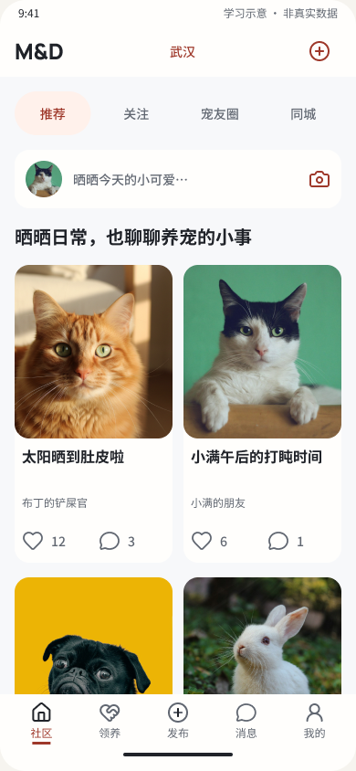
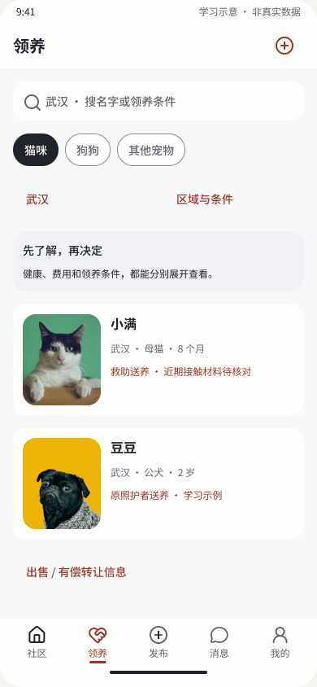
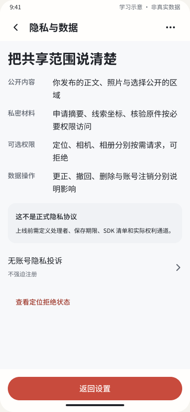
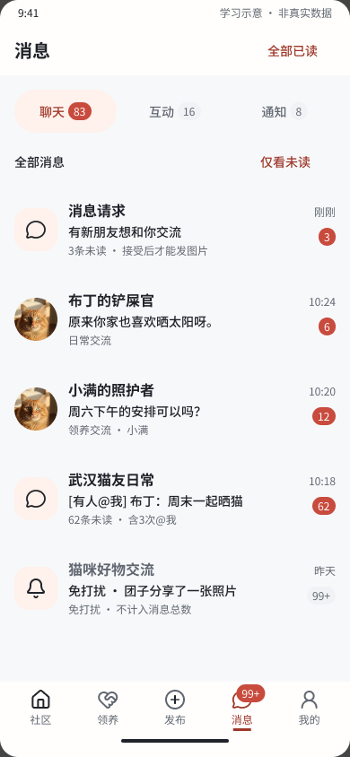
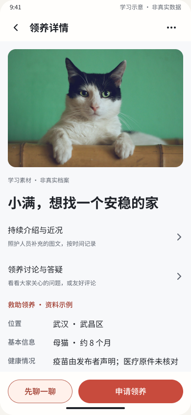
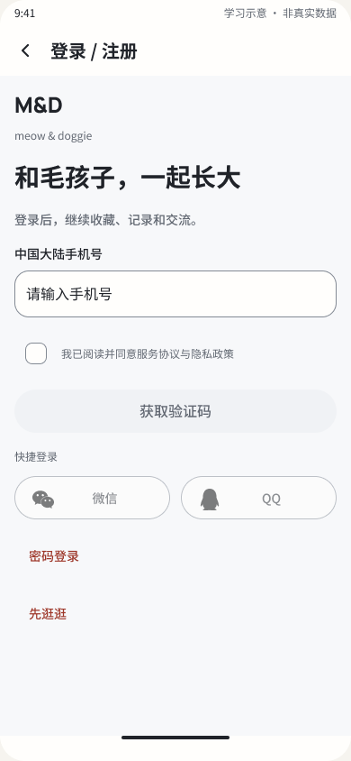
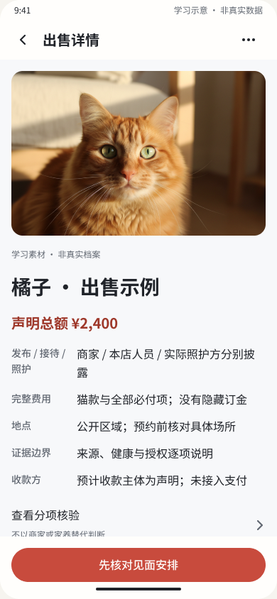
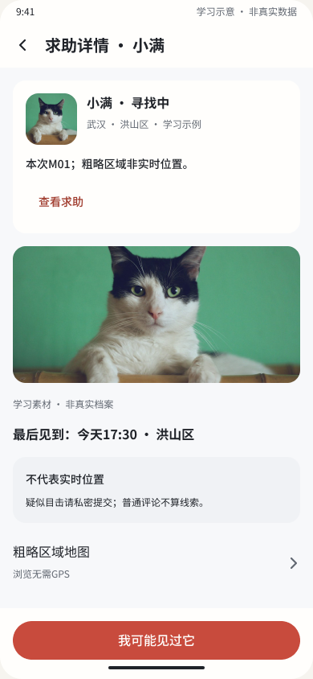
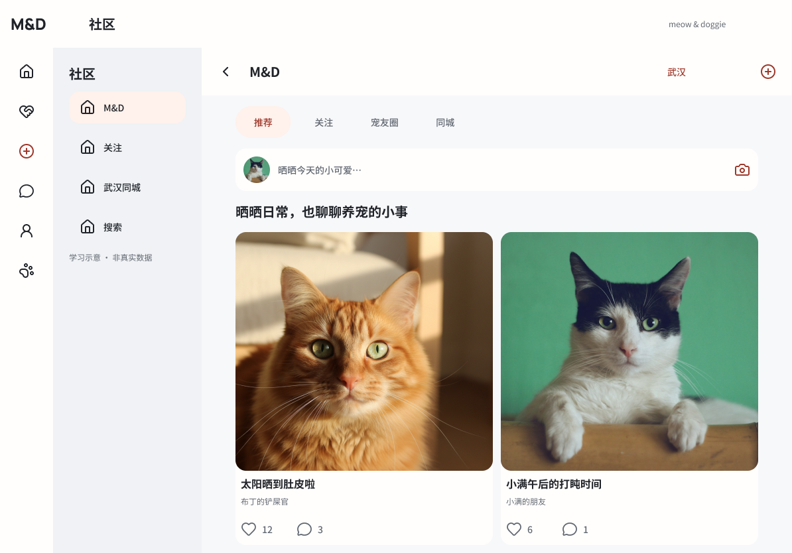

# M&D 产品、合规与 Figma 审查

日期：2026-10-21，UTC+08:00。任务：AI-20261021-PRODUCT-AUDIT。

## 结论与证据边界

**主干设计较完整，尚不能认定达到公开首发的完整程度。** 猫优先的品牌、社区／领养定位、分项核验、商业关系与费用披露、私密线索、举报申诉方向应保留。主要短板是安全异常的收尾、各份合同的一致性，以及合规要求是否进入实际产品和运营。

本轮核对当前工作树 `main@ebfc469c9707bf0ea4a6b383840546077ae65782`，包含大量未提交／未跟踪成果；不是只审查 HEAD。阅读当前产品、认证、信任、客户端和服务端资料；实时读取 Figma 文件 `3OFOC3vu18Kx9sRPjummOC` 的页面目录、代表节点、结构及 9 张截图，截图已原样保存并打开确认；核查中国大陆官方法律法规，时点为本报告日期。

本轮是**产品规格静态审查、Figma 代表状态取样和合规风险筛查**。没有点击遍历完整原型，没有全量验收所有画板，没有检查实际经营证照或真实生产环境。截图不能证明读屏、焦点、软键盘、提交、跨端同步或实际服务可用。未发现资料不等于现实中从未办理；未上线的设计缺口不等于已发生违法。

优先级：P0＝相关能力公开上线前必须解决或核实的门槛；P1＝高影响设计／合同修正；P2＝信息表达与细节改进。P0不表示已发生法律违法事实。下文“建议”均未自动变更已确认范围；本轮未改业务代码或远端 Figma。

## 一、产品完整性

| 编号／优先级 | 当前证据与触发情形 | 后果与建议 |
|---|---|---|
| A01／P0：认证已有新规则，设计与服务未同步 | [认证规划](MND_MOBILE_AUTH_PLAN.md)第0节及AUTH-22～24要求同账号三唯一标识、日常免强制短信、交流前验证当前手机号；[服务端接入核对](../server/CLIENT_READINESS_2026_10_20.md)第23行明确B04未落地。当前登录画板仍以手机号短信为首要入口 | 属于“已设计但未交付”，不是要求重新发明登录。同步邮箱、换绑、恢复、资格不足与返回编辑状态；由服务端统一执行相关写关卡，保留客户端现有拦截，验证后不自动发送原稿 |
| A02／P1：同宠物的多申请缺少独占试养联动 | [PRD](../bmad/prd.md)第99–103行分别定义可用性和申请；[rescue.go](../../internal/mobile/rescue.go)第462–492行通过／确认试养只改本申请，宠物级交接检查在第515行以后，结束时关闭Offer但未联动其他申请 | 可出现两家都进入试养、另一家长期等交接。建议明确“多候选、单独占试养、其余候补”，进入独占阶段原子预留，完成／退出时通知和更新所有受影响申请。此为源码静态路径推断，未运行复现 |
| A03／P1：退养求助有入口，安全接回缺明确终态 | [mobile-completion-content.json](figma-study/mobile-completion-content.json)第3343–3366、3612–3629行及账本trialExit／adoptionSupportPending到“发送接回协商／继续沟通”；rescue.go第542–551行仅创建支持工单、转return_requested | 需要接回提议、接受／拒绝／失联、到期人工介入、双方确认实际接回、重新匹配的合同。不能把“求助发送成功”算作宠物已经安全返回。此项依据本地规格与源码；未全量回读远端退养画板 |
| A04／P1：预约变更的权威合同相反 | PRD第111行及[信任规范](MND_TRUST_AND_DISCLOSURE_SPEC.md)第88行仍要求原安排暂停；[客户端矩阵](../client/FEATURE_DELIVERY_MATRIX.md)第101–105行及[服务端架构](../server/ARCHITECTURE.md)第48行改为保留effectiveVersion、另列pendingProposal | 最新架构已有替代说明，旧PRD／信任规范仍会误导客服和开发。统一为同一合同，并区分普通改时间与原地点不可用、宠物／主体失实、健康重大纠正等安全事件；后者需要显式暂停行动或取消出口 |
| A05／P0：游客安全／隐私报告尚不能真实受理 | 信任规范第157、206行已有免注册通道；服务端接入核对第27行明确v2仍要求登录 | 受害人可能为删除自己的信息而被要求注册。补受限游客工单、真实回执、脱敏查询和紧急处置分流；不能用固定成功稿代替受理 |
| A06／P1：双城运营缺可执行服务边界 | [冷启动规范](MND_COLD_START_LOST_PETS_AND_AUTH_SPEC.md)第21–25、186行及PRD第461行保留城区、授权来源、值守、撤回维护等待办 | 武汉／上海分别明确试点区域、数据来源授权、负责人、服务时段与容量；没有值守能力时如实提示，不承诺即时响应。已有真实空态与来源透明方向，应继续保留 |
| A07／P2：求助表单与真实世界不确定性不一致 | 冷启动规范第21、84–87、101行允许其他允许物种、约略／未知时间和区域描述；[models.go](../../internal/mobile/models.go)第51–64行及rescue.go第37–44行使用必填时间、非可空坐标、仅cat／dog校验 | 无准确时间／GPS的人会被迫填假值，默认0,0还可能误标地点。建议时间精度与位置精度独立建模，坐标可空，明确其他物种首发范围；未知位置显示区域／列表 |

另需进入首发清单：发布结果不明时的幂等与结果核对；注销、媒体、日志及备份的生命周期。两项均已在接入核对列为缺口，不应把历史完成标记当作实际闭环。

## 二、中国大陆运营的合规风险

### L01／P0：不代收款不是排除平台责任的依据

PRD第13、17行允许商家／个人／披露代理售猫、有偿转让与预约。按实际流程判断，具有较强交易平台属性；信息发布、交易撮合本身就在法定定义中，支付在站外完成不是单独的免责理由。《电子商务法》第9、27、29、31、38条涉及平台定义、经营者核验、违法处置、资料留存及相关责任。[电子商务法官方原文](https://www.cac.gov.cn/2018-09/01/c_1123362506.htm?isappinstalled=0)

需要把普通账号认证与经营者入驻核验分开，落实经营主体、适用许可、公示、更新与退出后的必要证据保留。核验小商家是否适用登记例外，不应一律要求相同证照，也不能接受“个人”标签规避实际经营属性。若属于涉税信息报送规则中的平台企业，还需核对主体与报送义务。[国务院第810号令](https://shanghai.chinatax.gov.cn/zcfw/zcfgk/swzsgl/202506/t476759.html)

### L02／P1：平台规则需要完整生命周期

如实际属于网络交易平台，2026-02-01已生效的《网络交易平台规则监督管理办法》不仅要求一个协议链接，还涉及规则的持续公示、检索／阅览／下载、意见征集、变更公示、历史版本和处置申诉。第7–16、19–21条应映射到产品和运营。[2026正式办法](https://www.cac.gov.cn/2026-01/07/c_1769515215345420.htm)

当前已有举报与申诉设计，但仍应补规则中心、版本／生效时间、历史查阅、变更通知、处置依据与人工申诉。不能把“平台不承担任何责任”写入格式条款替代法定义务；免责与提示应按具体行为和责任判断。[民法典第496、497、506条](https://fgk.chinatax.gov.cn/zcfgk/c100009/c5212250/content.html)

### L03／P0：真实身份资格必须落实在服务端

2026-01-01起施行的修正《网络安全法》相关实名条款为**第26条**；信息发布与即时通讯需按要求真实身份认证。APP规定第6条允许手机号、身份证件等认证方式，不能把法律解释为每次登录必须短信或只能使用手机号。[现行网络安全法](https://www.cac.gov.cn/2025-12/29/c_1768735112911946.htm)、[APP信息服务规定](https://www.cac.gov.cn/2022-06/14/c_1656821626455324.htm)

本项目当前确认的手机号交流资格应先完成B04，再放行写入。普通微信OAuth返回OpenID／昵称本身不足以证明已经满足真实身份核验；替代方案需要合法验证链和明确产品决定，不能直接放开。

### L04／P0：精确位置、身份及家庭材料缺处理与删除清单

现有设计正确区分公开区域和私密线索，并限制原件访问；但服务端接入核对第29行仍将注销、保留期限、物理清理与多副本列为待确认。应根据具体个人数据确定最小范围、处理依据、告知、敏感信息单独同意、对外提供／公开条件、影响评估和权利响应。[个人信息保护法第6、17、19、23、25、28–31、47、55–56条](https://www.cac.gov.cn/2021-08/20/c_1631050028355286.htm)

落实字段—目的—可见人—处理方—期限—删除例外清单，覆盖EXIF、照片中的电话／门牌、分享预览、SDK、日志、CDN、备份与审核下载件。宠物照片并非当然属于敏感个人信息，要判断是否关联自然人的行踪、证件、人脸或家庭情况。法定交易记录不能与家庭原件统一套同一保留期，也不能承诺注销后所有法定记录立即消失。

2026-09-01已生效的小型个人信息处理者简化规定，对符合境内处理不满10万人等适用条件的主体提供简化方式；这能降低评估／审计成本，但不取消敏感信息单独同意和相应保护要求。[小型处理者正式规定](https://www.jswx.gov.cn/zhengce/fagui/202607/t20260724_1346695.shtml)

### L05／P0：未成年人尚无完整产品与运营路径

本次审阅的PRD角色表、认证资格表和信任规则未形成年龄层、监护授权、未成年人社交保护的完整合同。手机号验证不能代替年龄与监护关系。不满14岁个人信息有专门保护要求；社交服务还涉及未成年人模式、网络欺凌防护及相关个人信息审计等义务。[未成年人网络保护条例第26、31、37、43条](https://www.cac.gov.cn/2023-10/24/c_1699806932316206.htm)

先确定服务年龄范围，再落实必要而最小化的年龄判断、不满14岁监护授权、陌生人联系／屏蔽、监护权利和申诉。将首发的商业发布、线下预约与领养签约限成年人是可考虑的产品取舍，不是法律一律禁止未成年人领养的结论。本轮未全量穷举Figma所有画板，不据文档缺口宣称全文件绝无任何年龄字样。

### L06／P0：实际受理与内容处置能力要先成立

A05的游客通道缺口，加上PRD仍待确认的人员／时段，说明不能仅凭“举报成功”界面认为具备运营能力。现行网络安全法第49、51条涉及违法内容处置、留证／报告以及公布和处理安全投诉举报。[现行网络安全法](https://www.cac.gov.cn/2025-12/29/c_1768735112911946.htm)

免注册是本项目已有通道要求，不应概括成一切投诉法律均要求匿名。应提供真实队列、人工责任人、分级处置和回执；图片、用户名、私信与群聊也纳入。普通材料争议与违法内容／隐私泄露的紧急处理分开，服务时限不能拖延依法应立即采取的行动。

### L07／P0待核实：备案与许可不能从页面推定

当前资料不能证明经营主体、网站／APP备案与许可已经齐备，也不能据此断言从未办理。境内APP信息服务需按通知履行备案；网站备案不自动覆盖APP。[工信部APP备案通知](https://www.miit.gov.cn/jgsj/xgj/wjfb/art/2023/art_dd783a581c9644a4aee10afa582811db.html)

经营性信息服务许可、可能涉及的EDI等，取决于收费、撮合、合同／订单处理、运营主体与部署模式，应依据实际流程及主管部门口径核定，不能给“没支付只要备案”或“宠物APP一律两证”的结论。社区、群组、信息分享还需核对舆论属性／社会动员能力安全评估适用要求；安全评估不等于另一个行政许可证。[现行互联网信息服务管理办法入口](https://xzfg.moj.gov.cn/front/law/detail?LawID=1756&Query=)、[安全评估规定](https://www.cac.gov.cn/2018-11/15/c_1123716072.htm)

### L08／P1：同城交接不能代替动物准入与检疫

物种与健康字段不等于已经具备禁限售、来源及检疫控制。《动物防疫法》第29、49、51条及适用规程涉及禁止经营情形、出售／运输前检疫与证明；“同城见面”不能直接排除出售前的适用义务。[动物防疫法](https://fgs.moa.gov.cn/flfg/202104/t20210425_6366545.htm)、[2023犬猫检疫规程](https://yyj.moa.gov.cn/tzgg/202304/t20230404_6424723.htm)

补物种准入／禁限售表、经营证照与检疫字段、核验时间和失效处置。“其他宠物”不能默认包括受保护野生动物；相关展示／广告也应把关。[野生动物保护法现行正文](https://www.beijing.gov.cn/zhengce/zhengcefagui/qtwj/202307/t20230707_3157872.html) 首版排除跨城运输应保留；未来物流需另审承运、防疫与禁限寄条件，不能承诺所有活体都能寄。健康科普与材料核对也不能直接变成无资质诊疗或健康保证。[动物诊疗机构管理办法](https://www.beijing.gov.cn/zhengce/zhengcefagui/qtwj/202505/t20250527_4098820.html)

### L09／P1条件触发：推广、算法与核验表达

分项核验方向正确，未发现本轮样本在宣称“100%健康／真实”。继续在徽章附近展示核验事项、时间与有效性，不能只在末尾免责。若增加付费曝光／竞价或符合规定的商业推荐，应落实广告识别与审核；不是所有商家客观信息都一律属于必须贴标签的广告。[互联网广告管理办法第9条](https://www.samr.gov.cn/zw/zfxxgk/fdzdgknr/fgs/art/2023/art_d93a579afd45413e8576e4623fab348f.html)

若采用适用的推荐算法，再落实关闭个性化、标签控制及条件触发的备案义务；不能把手动时间序浏览一律当成需算法备案。[算法推荐规定第17、24条](https://www.miit.gov.cn/jgsj/waj/wjfb/art/2022/art_a6ae77ea1f5e401eb8cc6819b869fdfa.html)

## 三、Figma 当前细节

实时页面已重组为项目／手机／Web／平板／桌面总览、分模块原稿、规范组件和历史归档。旧节点很多仍可访问；不能因页名变更宣称设计丢失，也不能凭旧目录和画板数量宣布最新能力齐全。

| 编号／优先级 | 当前具体证据 | 建议与边界 |
|---|---|---|
| F01／P0：登录入口落后于账号决定 | [56:70](https://www.figma.com/design/3OFOC3vu18Kx9sRPjummOC/MND?node-id=56-70)仍为手机号＋验证码；420:5功能24结构取样有旧手机号补充和Apple隐藏邮箱说明，未见对应新邮箱注册／验证码和当前手机号交流资格的新状态；认证规划也明确标“待补稿” | 按A01更新入口与状态，区分“登录成功”和“已获得交流资格”。已有手机号补充、第三方及iOS专用稿应复用，不应误报为全部缺失 |
| F02／P0：隐私页仍为正确标注的示意稿 | [56:76](https://www.figma.com/design/3OFOC3vu18Kx9sRPjummOC/MND?node-id=56-76)明确写“这不是正式隐私协议”，处理者、期限、SDK及真实权利通道待定义 | 学习稿这样标注是诚实做法；正式首发须替换为与真实数据流一致的版本，并补L04／L05。不能删掉示意字样就宣称合规 |
| F03／P1：领养详情的决策信息出现太晚 | [56:37](https://www.figma.com/design/3OFOC3vu18Kx9sRPjummOC/MND?node-id=56-37)，390×844：图片高240，近况和讨论两个入口排在事实前；必付费用节点58:428在正文y=676，即画面y=760，已在固定操作区下方，而“申请领养”一直可见 | 费用、关键条件、健康未知／核验摘要应先于近况和讨论，或在标题附近做紧凑决策摘要。这是信息优先级问题，不是“没有费用”或“正文不能滚动” |
| F04／P1：出售详情用规则句代替案例事实 | [56:78](https://www.figma.com/design/3OFOC3vu18Kx9sRPjummOC/MND?node-id=56-78)：总额¥2,400，但“完整费用”仅写“猫款与全部必付项；没有隐藏订金”；收款方写“预计收款主体为声明”；关系行“分别披露”孤字换行（60:2637，宽266、高52） | 用明确标注为示例的真实结构表达主体、角色、必付项目／金额与退款条件，合计能对上总额；写“发布者声明已列明全部必付项”并保留投诉出口，避免平台口吻保证没有隐瞒。拆角色行改善可读性。此结论仅针对该画板，不断言所有后续报价页缺明细 |
| F05／P1：最新全局未读尚未完成跨端对应 | 手机[356:8](https://www.figma.com/design/3OFOC3vu18Kx9sRPjummOC/MND?node-id=356-8)有聊天／互动／通知、请求和99+；当前平板总览[426:10995](https://www.figma.com/design/3OFOC3vu18Kx9sRPjummOC/MND?node-id=426-10995)明确写“本端尚未收录独立稿”；本地全局未读交接也标注完整跨端状态未接入 | 按最新计数、已读、失败／离线及请求语义补对应布局，不以旧569状态的跨端数量抵扣新增范围。静音是否计总数仍为待确认建议，不能冒称已确定 |
| F06／P1：规则中心与未成年人路径需纳入下一轮设计 | 目前受审认证／隐私／角色合同尚不能覆盖L02、L05；Figma现有协议总入口238:371765包含分开的协议／隐私／资料行 | 在已有设置与协议入口上扩展版本、历史、处理依据、监护与权利状态；不应报成“协议文字完全不能打开”或“没有隐私入口”。全文件与真实行为仍需专项验收 |

### 已核实的正向细节与排除项

- 主动作／返回等本轮核对的代表控件为48高或48×48；不能只看24像素图标就断言触控目标过小。
- 领养／出售页有明确滚动视口，固定底部动作与正文分开。平板横屏首页311:26虽正文超过首屏，但中间容器312:379838设置了VERTICAL滚动；排除最初仅查外层时产生的“内容不可滚动”候选。
- 登录协议句239:367913确有动作，指向238:371765；后者有独立协议／隐私相关行。12像素协议字可做可读性优化，但本轮不据此直接判定违法或WCAG不通过。
- 求助详情56:56明确“不是实时位置”、公开粗区域、线索私密，浏览无需GPS；这是正确的风险边界。
- 手机消息新稿将消息请求、未读数和免打扰区别显示；真实跨端计数与“全部已读”的行为尚未运行验证。
- 不根据近似截图颜色判对比度不通过；本轮没有完成全量色彩／透明度审计。也没有从Figma宣称读屏、键盘或设备无障碍合规。
- 学习数据和素材示例标识应保留，正式素材授权、第三方官方按钮与真实核验内容另行落实。

## 四、采样步骤与截图

下列为本轮直接导出的**代表状态取样顺序**，不是已经实际点击完成的端到端操作链。所有截图已保存并打开确认，Figma未被修改。完整映射见[截图清单](figma-study/audits/2026-10-21-product-compliance/manifest.json)。

| 步骤 | 状态 | 健康判断 |
|---|---|---|
| 1 | 手机社区首页56:27 | 视觉主干清楚；实际推荐、内容来源及状态恢复未验证 |
| 2 | 手机领养列表56:35 | 物种和商业分支可达；真实筛选与空态未运行 |
| 3 | 隐私与数据56:76 | 公开／私密边界清楚；正式处理规则仍待补 |
| 4 | 手机消息356:8 | 新未读表达清楚；完整跨端与服务语义未接入 |
| 5 | 领养详情56:37 | 重要决策信息排序应调整，费用在首屏下方 |
| 6 | 登录56:70 | 沿用旧认证；尚未同步最新三标识方案 |
| 7 | 出售详情56:78 | 有总价与披露框架；示例事实和措辞不足 |
| 8 | 求助详情56:56 | 粗位置／非实时／私密线索边界良好；真实地图未验证 |
| 9 | 平板横屏首页311:26 | 导航／主内容及滚动结构存在；实际窄窗、键盘与读屏未验证 |

### 1. 手机社区

### 2. 领养列表

### 3. 隐私与数据

### 4. 全局未读

### 5. 领养详情

### 6. 登录

### 7. 出售详情

### 8. 求助详情

### 9. 平板横屏

## 五、建议的处理次序

1. 先冻结影响上线的合同：服务年龄、经营主体／收费与平台边界、B04、数据保留与投诉值守；把预约旧规则更新到同一版本。法律适用依赖的实际经营事实形成清单，不凭设计推测证照状态。
2. 补试养独占、候补联动、安全接回与异常人工接管；同步产品状态、Figma文案和服务合同。
3. 更新认证、正式隐私／未成年人路径、规则中心、领养决策摘要、出售明细与最新跨端未读状态。沿用当前浅色、字体、组件、猫优先方向，不需重新换视觉体系。
4. 在获得对应运行授权后，验收公开浏览→认证→发布／申请→预约→试养→双确认交接→异常接回→私密回访→举报申诉的真实纵向闭环，再扩大公开范围。案例回放需要真实负责人和异常处理记录，不能用画板数量抵扣。

仍待业务事实：运营法人及住所、收费／广告／佣金、站内是否形成合同／订单、服务年龄、SDK与数据流向、两城运营排班、经营者与检疫责任分工。首发前依据这些事实确认最终许可与规则适用；本报告不出具“已完全合规”的结论。

## 验证与本轮修改边界

本轮新增本报告、9张原样截图和映射清单，并更新本任务跟踪。未改应用代码、远端设计、全局规则或其他会话的执行登记；未提交／推送。

完成的是文档与源码静态审查、当前远端代表节点回读和截图检查。未运行编译，遵循全局不自行编译规则。构建、实际测试、服务／迁移、供应商联调、真实经营证照和设备验收均未验证。不能将本次审查标记为客户端或合规验收通过。

交付物静态检查：5个文本文件为UTF-8无BOM，90个本地链接有效；9张PNG的文件头与尺寸和清单一致，新报告与清单无尾随空白。此检查没有运行应用、测试或构建入口。
