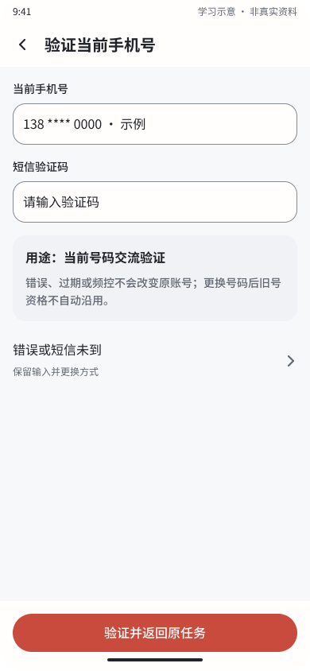
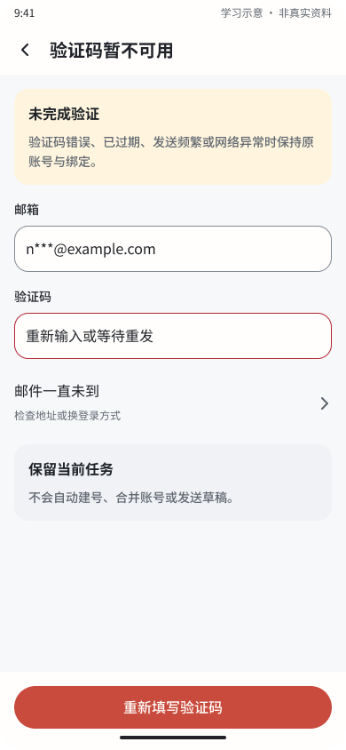
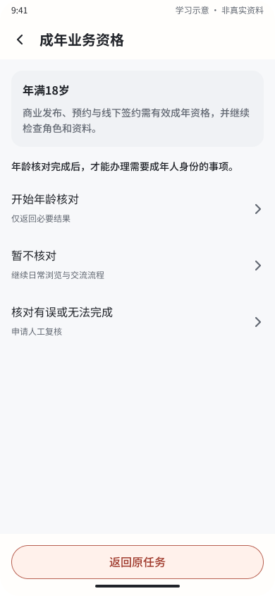
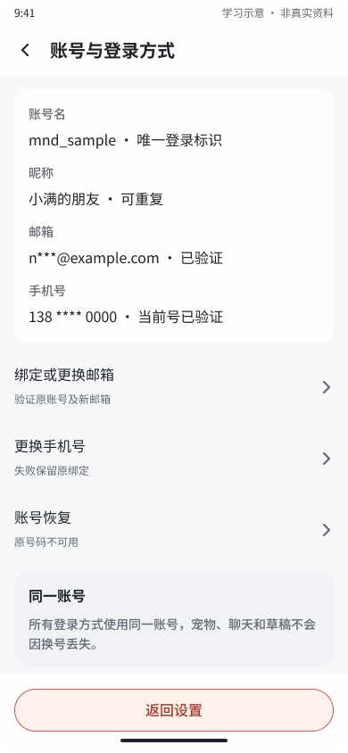
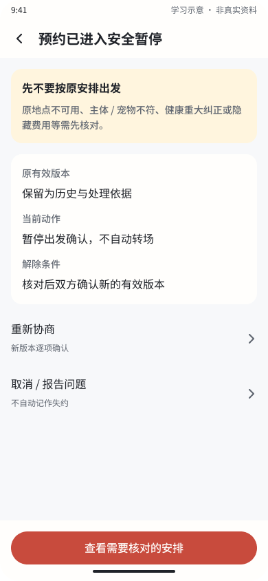
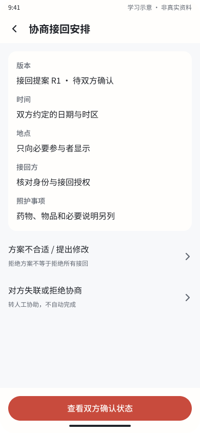
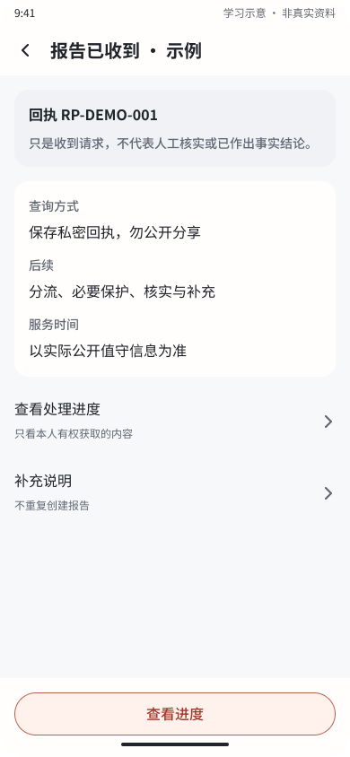
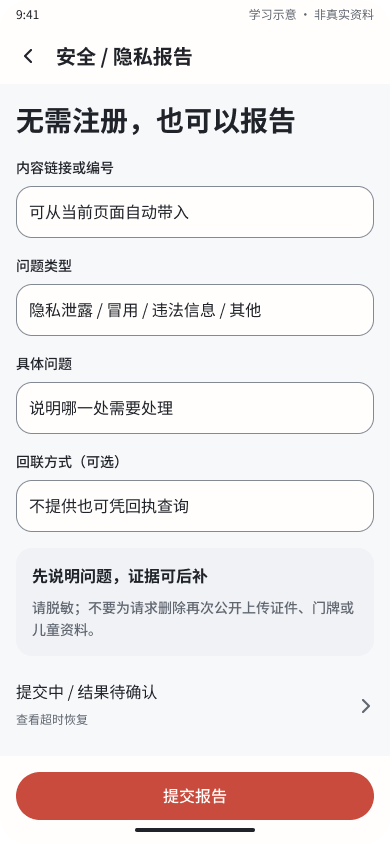
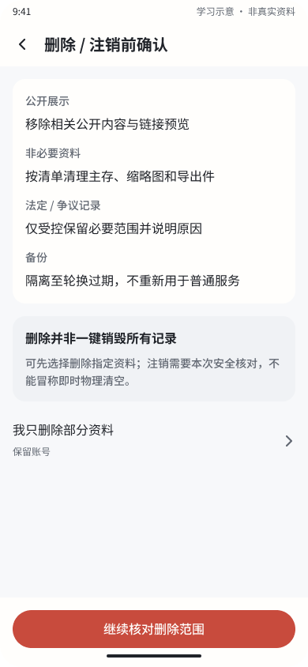
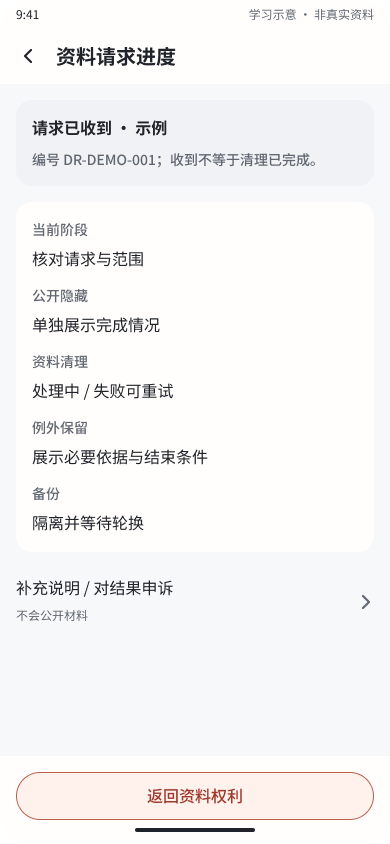

# M&D 逻辑与设计完整性复审

日期：2026-10-21（UTC+08:00）。任务：AI-20261021-LOGIC-REVIEW。当前工作树 `main@ebfc469`，保留既有未提交与未跟踪成果。

后续状态：用户已授权完善，六项已完成产品合同和Figma修订，并通过[最新静态条件回读与截图检查](LOGIC_FIX_HANDOFF_2026_10_21.md)。下文保留修订前的原始发现与证据，真实接口和设备仍未验收。

**结论：当前不能判定逻辑和设计已经完整。本轮确认6处P1设计逻辑缺口。** 页面和目标链接存在，不等于按钮兑现了其承诺；上一轮“完成”仅指那轮修订与结构检查完成，应以本次语义审查补充其边界。

本次只读核对最新远端Figma：6组问题页面×5布局共30根、10组手机关键页的文案与动作、原设置及可复用的取消／注销验证稿；新捕获并查看10张手机截图。没有修改远端或业务代码，没有播放原型逐条操作，也没有运行应用。采用当前文件与[原安全合同](../MND_SAFETY_AND_LIFECYCLE_SPEC.md)，没有将历史截图作为本轮视觉证据。

- [当前动作回读](audits/2026-10-21-logic-review/remote-edges.json)
- [本轮10张截图清单](audits/2026-10-21-logic-review/manifest.json)
- [上轮修订交接](DESIGN_CLOSURE_2026_10_21.md)：记录仍保留，不改写为已经通过本次业务逻辑验收。

## 1. 六处确认问题

### LR01 / P1：短信失败路径串到邮箱验证

- 触发：当前手机号交流验证中，点击“错误或短信未到”。
- 实际：`phoneCode`（460:17348）进入`emailError`（460:17328）。目标页出现“邮箱”“邮件一直未到”，底部继续回到邮箱验证码页。
- 影响：验证渠道与本次目的丢失，用户无法在当前手机号验证任务内正确重试。不是仅仅文案不一致。
- 五布局回读均指向各端emailError；源定义见[内容JSON](design-closure-2026-10-21-content.json:413)。
- 应修：单独当前手机号验证错误／未到／过期／频控状态，保留账号、号码、验证码用途和原任务；重试回到phoneCode。不能接回旧短信自动建号流程。

### LR02 / P1：成年核对入口没有接到核对流程

- 触发：成年业务资格页（460:17413）点击“开始年龄核对”。
- 实际：进入账号与登录方式（460:17358），只显示登录标识和绑定／恢复操作，没有成年核对步骤或结果。
- 影响：规则要求有效成年资格，但用户在设计主路径里没有完成资格核对的办法。不是判定已发生越权；当前后台门槛依然未接通。
- 五布局相同；源定义见[内容JSON](design-closure-2026-10-21-content.json:1010)。
- 应修：核对前告知、独立验证入口、处理中／取消／失败／不支持／结果失效状态，以及通过后回到原商业／预约任务；服务不可用时保留限制，避免假成功。

### LR03 / P1：安全暂停的取消出口实际只有举报

- 触发：安全暂停页（460:211421）点击“取消 / 报告问题”。
- 实际：五布局均进入安全／隐私报告表单，而非取消确认。提交报告并不表达预约被取消。
- 影响：想退出预约的用户可能以为举报已经取消，双方对是否继续见面产生不同理解。
- 原取消确认稿240:368306仍存在，因此不是整个文件没有取消设计，而是新增安全路径没有正确接通。
- 应修：拆成独立“取消本次预约”与“报告问题”。取消显示对象、原因、后果和确认结果；保留安全暂停上下文，不将“保留预约”误接为普通已确认或恢复出发。投诉不自动取消，取消也不自动视为投诉。
- 源定义见[内容JSON](design-closure-2026-10-21-content.json:2386)。

### LR04 / P1：接回提案仍是规则说明，没有形成双方可操作的方案

- 触发：接回请求（460:68727）发送后进入接回安排（460:68732）。
- 实际：前页只填写原因和可联系安排；方案页列“双方约定的日期与时区”“只向必要参与者显示”“核对身份与接回授权”等说明，没有具体方案编辑。主按钮“查看双方确认状态”直接到已确认示例。
- 影响：尚未表达由谁填写时间／地点／接回方、另一方怎样查看同一版本并接受／拒绝／修改；不能据状态示例判为双边确认流程完整。
- 五布局均复用这条路径；源定义见[内容JSON](design-closure-2026-10-21-content.json:2186)。
- 应修：发起方编辑→版本预览→提交待回应→接收方接受／拒绝／修改→等待双方→已确认。补撤回、过期、并发与资格变化；实际接回确认仍与方案确认分开。

### LR05 / P1：已有回执的补充说明回到新建报告

- 触发：已有RP回执（460:68697）点击“补充说明 / 不重复创建报告”。
- 实际：五布局均返回普通新建报告表单（460:68682）。表单仍要求对象／问题类型，主按钮为“提交报告”，未展示原回执及追加模式。
- 影响：设计承诺不会重复创建，但没有表达把补充附加到同一工单的方式；实现者容易沿新建接口处理。此为设计风险，不是已经复现数据库重复工单。
- 应修：显示原回执与允许补充范围，使用“提交补充”及独立失败／结果不明状态，返回同一工单进度；游客凭据受限并处理过期、丢失与无权访问。
- 源定义见[内容JSON](design-closure-2026-10-21-content.json:1892)。

### LR06 / P1：删除／注销从“继续核对”直接进入受理结果

- 触发：设置→账号数据与注销→个人资料权利→删除／注销前确认（460:17443）。
- 实际：“继续核对删除范围”五布局均跳到“请求已收到”DR示例（460:17448）。中间没有选定删除／注销范围、本次身份核对及最终提交确认。
- 影响：尚未提交的操作显示为已受理，且用户不清楚本次到底是删除部分资料还是注销账号。
- 原身份核对稿238:371759仍存在；本轮设置重接到新资料路径后没有串回它。原稿仅手机号验证，若复用仍须按新账号规则完善，不能原样当作新合同已满足。
- 应修：范围选择→未完成事项／影响→必要身份核对→明确最终提交→受理／不明／失败→对应请求进度。取消核对保留原资料与草稿。
- 源定义见[内容JSON](design-closure-2026-10-21-content.json:1330)。

## 2. 本轮步骤与画面证据

这是6条独立分支的设计走读顺序，编号不是同一个用户连续执行的全部操作。跳转目标由当前Figma动作读取确认，未把URL读取说成已实际点击或业务命令成功。

| 步骤 | 画面与健康情况 | 截图 |
|---|---|---|
| 1 | 当前手机号验证：正常入口清楚，错误出口目的不符 |  |
| 2 | 邮箱错误：作为短信失败落点有误 |  |
| 3 | 成年资格：规则说明清楚，开始核对入口未接通 |  |
| 4 | 账号列表：没有成年核对操作，不能完成步骤3目标 |  |
| 5 | 安全暂停：不出发提示明确，取消与报告混为一个动作 |  |
| 6 | 接回方案：缺具体方案编辑及另一方明确确认步骤 |  |
| 7 | 回执：收到与核实区分正确，补充操作上下文丢失 |  |
| 8 | 新建报告：可以表达初次报告，未表达追加已有回执 |  |
| 9 | 删除前：保留例外说明清楚，继续核对却跳过后续确认 |  |
| 10 | 资料进度：显示已收到，需要前置真实提交确认 |  |

## 3. 视觉与无障碍判断

10张当前截图的标题、信息分组、安全提醒和主要按钮整体清楚，本次未在这些取样图中发现新的明显重叠／裁字。主要问题是操作与结果语义、双边角色和确认步骤，继续增加相同样式画板不能代替修复。

图中可见的表单标签与错误边框有明确区分；错误原因仍把验证码错误、过期、频控和网络失败合并，实际交互需按原因给可执行提示／等待时间。截图不能证明输入语义、读屏错误关联、键盘焦点、放大重排或软键盘遮挡已经通过。本次没有重新证明全套颜色对比或无障碍符合性。

## 4. 修正后的验收条件

| 分支 | 至少应走通的情况 |
|---|---|
| 短信 | 当前号码错误／过期／频控／未到→仍留短信交流验证，原任务不丢、不切注册 |
| 成年核对 | 同一成年人核对取消／失败／成功／失效→正确原任务与业务资格，不把普通账号列表当验证 |
| 安全暂停 | 报告不取消；取消明确通知双方；取消核对退出后仍保持暂停，不恢复出发 |
| 接回 | A提案、B修改、A拒绝、同版双确认；版本过时和一方交接都不自动完成 |
| 报告补充 | 新报告与追加分开；弱网恢复仍指同一回执，无凭据不能查看他人工单 |
| 删除／注销 | 未最终确认前不显示收到；安全验证取消不创建请求；部分删除和注销的范围／回执各自准确 |

本次没有扩大为服务端或经营资质审查。B04、真实年龄／监护核验、游客工单、数据清理、运营主体和人工受理等上轮发布门槛仍未因这些画板存在而完成。未运行编译，遵循全局不自行编译规则；应用测试、设备与接口联调均未验证。

执行结果：本轮复审与证据交付完成，6项问题仍待修订，不能标记为“产品逻辑已全部完成”。本轮没有修改远端Figma、原产品合同或业务实现。
