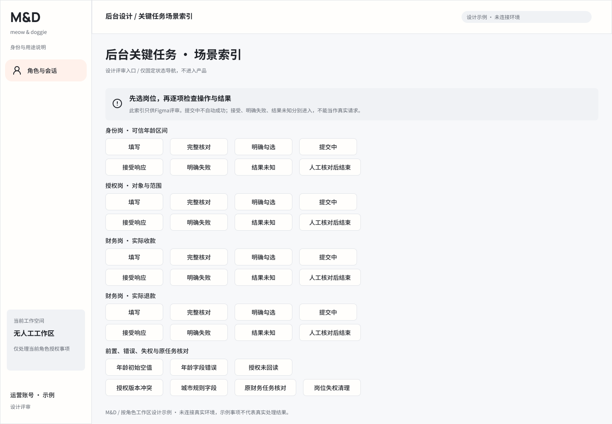
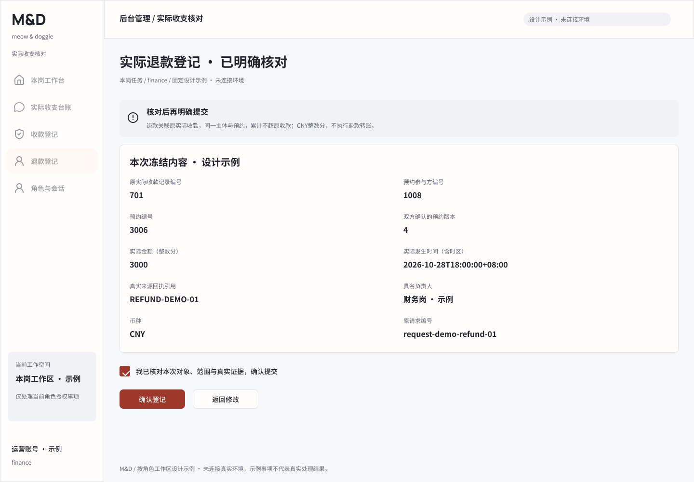
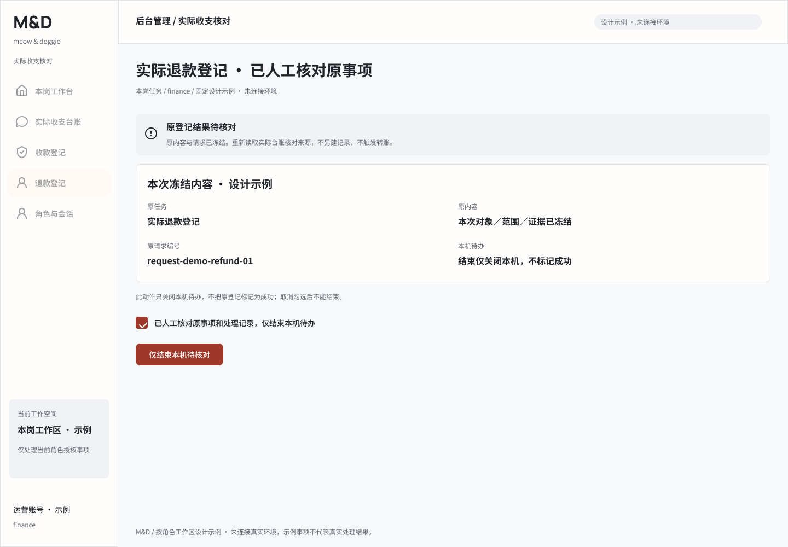
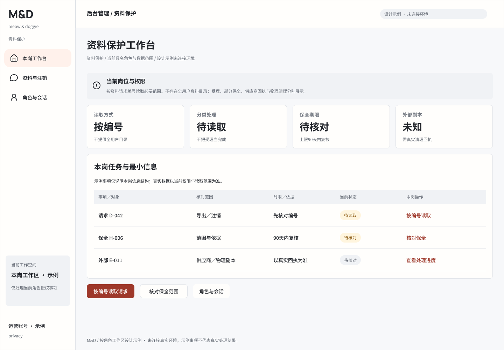
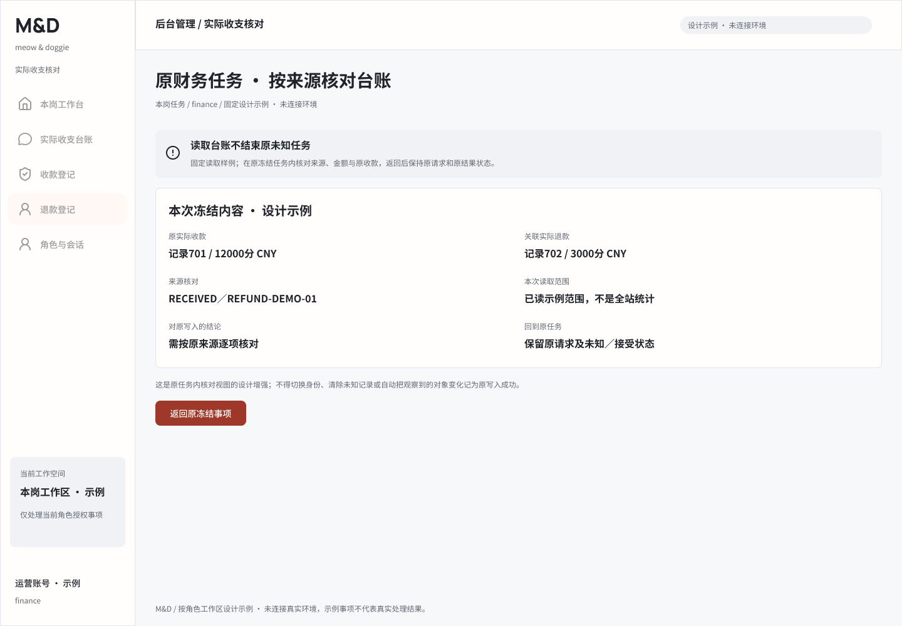

# 后台任务交互稿与本轮证据

2026-10-29。沿用角色页888:1402。[打开场景索引](https://www.figma.com/design/3OFOC3vu18Kx9sRPjummOC?node-id=932-2803) · [详细交互合同](../../ADMIN_TASK_INTERACTION_2026_10_29.md) · [节点／原型／验证](state-and-validation.json)。

新增39张业务任务状态和1张仅供Figma评审的索引；4类任务的完整核对、明确勾选、提交中、接受／失败／未知及人工核对后结束分别表达。两态确认控件复用当前字体、语义变量和check图标，无新Token。资料岗两处侧栏收敛为三项，原保全任务继续存在。原18角色稿的21个入口转向新的具体任务稿。

本轮静态回读40根、891个实例、173个原型动作；未发现缺目标、自循环、正文越界或字体家族偏差，IMAGE填充为0。未勾选的确认登记无动作；发送中不自动成功；未知结果不通往成功。9张本轮PNG已实际打开，截图为取样视觉检查，不是全部画板逐像素或运行验收。

| 状态 | 稳定节点 |
|---|---|
| 可信年龄区间 · 填写 [age-edit] | [927:1225](https://www.figma.com/design/3OFOC3vu18Kx9sRPjummOC?node-id=927-1225) |
| 可信年龄区间 · 完整核对 [age-review] | [927:1329](https://www.figma.com/design/3OFOC3vu18Kx9sRPjummOC?node-id=927-1329) |
| 可信年龄区间 · 已明确核对 [age-confirmed] | [927:1427](https://www.figma.com/design/3OFOC3vu18Kx9sRPjummOC?node-id=927-1427) |
| 可信年龄区间 · 提交中 [age-sending] | [927:1528](https://www.figma.com/design/3OFOC3vu18Kx9sRPjummOC?node-id=927-1528) |
| 可信年龄区间 · 已收到接受响应 [age-accepted] | [928:1307](https://www.figma.com/design/3OFOC3vu18Kx9sRPjummOC?node-id=928-1307) |
| 可信年龄区间 · 明确失败 [age-rejected] | [928:1397](https://www.figma.com/design/3OFOC3vu18Kx9sRPjummOC?node-id=928-1397) |
| 可信年龄区间 · 结果待核对 [age-unknown] | [928:1492](https://www.figma.com/design/3OFOC3vu18Kx9sRPjummOC?node-id=928-1492) |
| 发布授权 · 填写 [authority-edit] | [928:1587](https://www.figma.com/design/3OFOC3vu18Kx9sRPjummOC?node-id=928-1587) |
| 发布授权 · 完整核对 [authority-review] | [928:1701](https://www.figma.com/design/3OFOC3vu18Kx9sRPjummOC?node-id=928-1701) |
| 发布授权 · 已明确核对 [authority-confirmed] | [929:1508](https://www.figma.com/design/3OFOC3vu18Kx9sRPjummOC?node-id=929-1508) |
| 发布授权 · 提交中 [authority-sending] | [929:1620](https://www.figma.com/design/3OFOC3vu18Kx9sRPjummOC?node-id=929-1620) |
| 发布授权 · 已收到接受响应 [authority-accepted] | [929:1712](https://www.figma.com/design/3OFOC3vu18Kx9sRPjummOC?node-id=929-1712) |
| 发布授权 · 明确失败 [authority-rejected] | [929:1802](https://www.figma.com/design/3OFOC3vu18Kx9sRPjummOC?node-id=929-1802) |
| 发布授权 · 结果待核对 [authority-unknown] | [929:1897](https://www.figma.com/design/3OFOC3vu18Kx9sRPjummOC?node-id=929-1897) |
| 实际收款登记 · 填写 [received-edit] | [929:1992](https://www.figma.com/design/3OFOC3vu18Kx9sRPjummOC?node-id=929-1992) |
| 实际收款登记 · 完整核对 [received-review] | [929:2109](https://www.figma.com/design/3OFOC3vu18Kx9sRPjummOC?node-id=929-2109) |
| 实际收款登记 · 已明确核对 [received-confirmed] | [929:2230](https://www.figma.com/design/3OFOC3vu18Kx9sRPjummOC?node-id=929-2230) |
| 实际收款登记 · 提交中 [received-sending] | [929:2354](https://www.figma.com/design/3OFOC3vu18Kx9sRPjummOC?node-id=929-2354) |
| 实际收款登记 · 已收到接受响应 [received-accepted] | [929:2451](https://www.figma.com/design/3OFOC3vu18Kx9sRPjummOC?node-id=929-2451) |
| 实际收款登记 · 明确失败 [received-rejected] | [929:2548](https://www.figma.com/design/3OFOC3vu18Kx9sRPjummOC?node-id=929-2548) |
| 实际收款登记 · 结果待核对 [received-unknown] | [929:2648](https://www.figma.com/design/3OFOC3vu18Kx9sRPjummOC?node-id=929-2648) |
| 实际退款登记 · 填写 [refund-edit] | [929:2750](https://www.figma.com/design/3OFOC3vu18Kx9sRPjummOC?node-id=929-2750) |
| 实际退款登记 · 完整核对 [refund-review] | [929:2871](https://www.figma.com/design/3OFOC3vu18Kx9sRPjummOC?node-id=929-2871) |
| 实际退款登记 · 已明确核对 [refund-confirmed] | [929:2995](https://www.figma.com/design/3OFOC3vu18Kx9sRPjummOC?node-id=929-2995) |
| 实际退款登记 · 提交中 [refund-sending] | [929:3122](https://www.figma.com/design/3OFOC3vu18Kx9sRPjummOC?node-id=929-3122) |
| 实际退款登记 · 已收到接受响应 [refund-accepted] | [929:3219](https://www.figma.com/design/3OFOC3vu18Kx9sRPjummOC?node-id=929-3219) |
| 实际退款登记 · 明确失败 [refund-rejected] | [929:3316](https://www.figma.com/design/3OFOC3vu18Kx9sRPjummOC?node-id=929-3316) |
| 实际退款登记 · 结果待核对 [refund-unknown] | [929:3416](https://www.figma.com/design/3OFOC3vu18Kx9sRPjummOC?node-id=929-3416) |
| 可信年龄区间 · 已人工核对原事项 [age-unknown-done] | [930:2349](https://www.figma.com/design/3OFOC3vu18Kx9sRPjummOC?node-id=930-2349) |
| 发布授权 · 已人工核对原事项 [authority-unknown-done] | [930:2449](https://www.figma.com/design/3OFOC3vu18Kx9sRPjummOC?node-id=930-2449) |
| 实际收款登记 · 已人工核对原事项 [received-unknown-done] | [930:2549](https://www.figma.com/design/3OFOC3vu18Kx9sRPjummOC?node-id=930-2549) |
| 实际退款登记 · 已人工核对原事项 [refund-unknown-done] | [930:2654](https://www.figma.com/design/3OFOC3vu18Kx9sRPjummOC?node-id=930-2654) |
| 发布授权 · 尚未读取当前版本 [authority-not-read] | [930:2759](https://www.figma.com/design/3OFOC3vu18Kx9sRPjummOC?node-id=930-2759) |
| 城市规则授权 · 独立字段参考 [authority-city-fields] | [930:2864](https://www.figma.com/design/3OFOC3vu18Kx9sRPjummOC?node-id=930-2864) |
| 发布授权 · 当前版本已变化 [authority-conflict] | [930:2983](https://www.figma.com/design/3OFOC3vu18Kx9sRPjummOC?node-id=930-2983) |
| 岗位权限已变化 · 原任务停止 [role-lost] | [930:3078](https://www.figma.com/design/3OFOC3vu18Kx9sRPjummOC?node-id=930-3078) |
| 原财务任务 · 按来源核对台账 [finance-ledger-check] | [930:3158](https://www.figma.com/design/3OFOC3vu18Kx9sRPjummOC?node-id=930-3158) |
| 可信年龄区间 · 初始未选择 [age-empty] | [930:3264](https://www.figma.com/design/3OFOC3vu18Kx9sRPjummOC?node-id=930-3264) |
| 可信年龄区间 · 字段待修正 [age-field-error] | [930:3366](https://www.figma.com/design/3OFOC3vu18Kx9sRPjummOC?node-id=930-3366) |
| 后台关键任务 · 场景索引 [adminTaskIndex] | [932:2803](https://www.figma.com/design/3OFOC3vu18Kx9sRPjummOC?node-id=932-2803) |

未播放原型、编译、构建、test、lint、类型检查或启动应用。财务原任务内核对捷径及所有逐端行为仍需与源码和运行分别验收；不把新稿当作新业务源码已实现。
