# M&D 普通手机版设计完整度审计

2026-10-16｜只读审查｜Figma 当前手机主版本 V2（页 56:25）｜未改画板或应用代码

## 结论

**尚未完善，不建议冻结为全量开发基线。** 目前有可评审的社区、领养、沟通、群聊、举报和账号骨架，但存在明显视觉错误、语义错误跳转，以及用户新增核心模块尚未进入原生设计的问题。134 屏不能等同于完整交付，也不应给一个没有可靠分母的完成百分比。

本轮重新获取并保存 **19 张 Figma 当前截图**，每张已打开检查；只读扫描全部 **134 个 390×844 根画板**，并逐项检查关键控件去向。没有使用旧 PNG 或生成式提案作为本次视觉验收证据。下方是 9 条审查路径，并非一条连续业务旅程。每条对应当前截图与具体问题。

这是设计稿与原型结构审查，不是实体手机测试、逐按钮点击走查或可上线应用验收。Figma 当前读取已恢复；原型仍是预设状态，未接通真实编辑、定位、消息或发布。

## 本轮结构检查：通过什么、不证明什么

| 项目 | 本轮结果 | 限定 |
|---|---|---|
| 原生手机根画板 | 134 个，全部 390×844 | 只证明当前参考尺寸，未验 320 宽或大字体 |
| 节点 | 6107（含 134 根），后代 5973 | 不把节点数当产品完成度 |
| 原型 NODE 动作 | 589，含 24 个 CHANGE_TO；另有 125 个 BACK | 目标存在不等于目标语义正确 |
| 起点与可达性 | 8 起点；首页可达 130 状态 | 另外 4 个异常有独立起点；不是断链证据 |
| 无效目标／缺失字体／占位闪烁 | 本轮指定检查均为 0 | 不等于完整无障碍或流程通过 |
| 命名主次按钮 | 检查 166 实例，均 48 高／24 圆角 | 不覆盖所有自定义操作；本轮未发现独立 ON_CLICK 目标小于 44 的示例，不代表完整触控验收 |
| 根背景 | **6 个实际为黑色**，同一背景变量解析应为 #F7F8FA | 明确失败，不是暗色主题 |
| 字体字号 | 12px 623 个、14px 502 个、16px 496 个等 | 12px 多为元信息，不自动判违规；重要提示仍需真机阅读验证 |

主按钮、卡片和输入的基本样式已有一致性；照片优先、商家与代理不自动定罪、未知健康事项不伪装核验、私密线索不公开等原则值得保留。下一阶段不应推翻已选风格，而应修正错误与补齐缺失。

## 需要处理的 10 项问题

### F01 · P1 · 六屏黑底与浅色文字系统不一致

证据：截图 01、03；节点 `56:27`、`56:28`、`56:32`、`56:33`、`56:34`、`56:61`。

Current 134-root scan: six actual solid black fills; same bound token resolves to #F7F8FA.

修正建议：修正根背景实际填充及生成时的回退颜色，保留变量绑定；重新检查六屏与主流程对比度。

### F02 · P1 · 走失线索进入错误的领养会话

证据：截图 08、16；节点 `60:1703`、`56:62`。

查看收到的线索 -> 56:62; destination title 小满的照护者 and application A1 adoption context.

修正建议：独立的本次事件线索收件箱、私密详情及联系入口；传递同一个 case ID、pet ID 和线索上下文。

### F03 · P1 · 找回／结束缺专用确认、处理与结果状态

证据：截图 08、17；节点 `60:1679`、`60:1686`、`56:83`。

Both owner status actions navigate to generic content-unavailable page with other-adoption link.

修正建议：拆分找回、其他结束和暂停；补确认、处理中、失败重试、已结案及全入口状态同步设计。

### F04 · P1 · 宠友圈尚未进入当前原生手机稿

证据：截图 01；节点 `56:27`。

Current top tabs are 推荐/关注/同城; 134-root inventory and text scan reveal no circle flow/audience/friend-request states.

修正建议：补圈首页、双向好友、发布预览、可见范围、评论隐私与冷启动等原生状态和入口。

### F05 · P1 · 多宠管理、独立日记、可见性与自有走失入口未闭环

证据：截图 04；节点 `56:74`、`60:2440`。

Pet profile is a fixed 小满 page; 添加狗狗或其他宠物 routes to adoption publishing basics 56:48. No diary/audience/missing-state destinations.

修正建议：独立宠物列表/切换/创建编辑；一宠一档日记、资料与日记受众、状态变更；不要复用领养发布代替个人宠物建档。

### F06 · P1 · 领养宠物详情缺持续介绍、更新与维护者补图

证据：截图 05、19、06；节点 `56:37`。

Full current detail text/actions contain static facts, verification, conditions, publisher, reporting and application; no update timeline/caretaker photo/comment thread.

修正建议：在单只领养宠物下设计持续更新、照片来源与时间、评论回复、照护角色、编辑历史与举报复核；申请仍引用同一宠物。

### F07 · P1 · 附近提醒设置与正常地图体验缺失

证据：截图 07、13；节点 `56:55`、`56:75`、`56:76`。

Map is empty-state explanation only; current roots/settings routes contain no 5–100 km subscription, species, center, channel or pause states.

修正建议：补粗略区域地图正常态、卡片联动与不可定位态；接收端独立订阅、5–100km范围、中心、物种、频率、权限拒绝和关闭设计。

### F08 · P2 · 全站表情和表态面板未设计到原生稿

证据：截图 02、10、11、18；节点 `106:1393`、`106:1409`、`106:1439`。

Current composers show input, camera and send only; native text inventory has no 表情 destination.

修正建议：统一帖子/评论/回复/私信/群聊/领养讨论的表情入口、面板、选中待发、取消、更换表态、命名和不可用状态。

### F09 · P2 · 不同评论的回复都进入同一条原评论

证据：截图 02、18；节点 `I108:2951;105:356`、`I108:2970;105:356`、`I108:2989;105:356`、`106:1396`。

All three reply controls target same frame whose parent comment is 团子今天不拆家.

修正建议：为不同回复对象提供对应上下文或限制示例入口；设计明确回复对象、取消回复、父评论被删/无权限及返回位置。

### F10 · P2 · 阅读领养条件误入申请表

证据：截图 05、19；节点 `58:438`、`56:39`。

领养条件 row navigates directly to 申请领养 form; no separate condition reading state.

修正建议：提供可展开的完整条件或独立阅读页，确认理解后再进入申请，不让阅读入口承担隐式申请动作。

P1 表示阻断当前主要体验或开发交接；P2 表示重要交互/一致性缺口。没有根据截图虚构安全事故、真实数据泄露或上线行为。

## 9 条审查路径与当前截图

### 1. 社区、评论与回复 — 未通过：黑底、圈子缺失、回复上下文错误

照片主导、喜欢/评论可发现是优点；但首页深字落在黑底上。三个不同回复入口均到同一条团子评论；当前只有推荐/关注/同城，没有宠友圈。对应 F01/F04/F09。

截图 01 · [Figma 当前画板](https://www.figma.com/design/3OFOC3vu18Kx9sRPjummOC/MND?node-id=56-27)

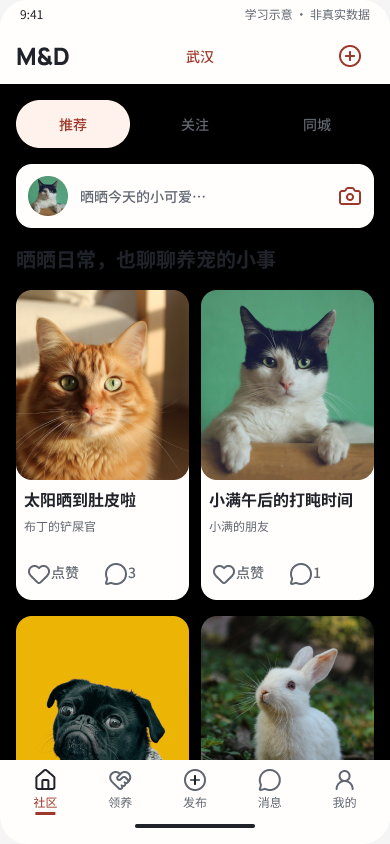

截图 02 · [Figma 当前画板](https://www.figma.com/design/3OFOC3vu18Kx9sRPjummOC/MND?node-id=106-1393)

截图 18 · [Figma 当前画板](https://www.figma.com/design/3OFOC3vu18Kx9sRPjummOC/MND?node-id=106-1396)

### 2. 图文发布 — 未通过：黑底；独立受众和表情未齐

照片示例与首版不做视频的方向一致，主按钮是完整胶囊。黑底让标题和字段标签难读；这一页不能代替一宠一日记、独立范围和表情能力。对应 F01/F05/F08。

截图 03 · [Figma 当前画板](https://www.figma.com/design/3OFOC3vu18Kx9sRPjummOC/MND?node-id=56-33)

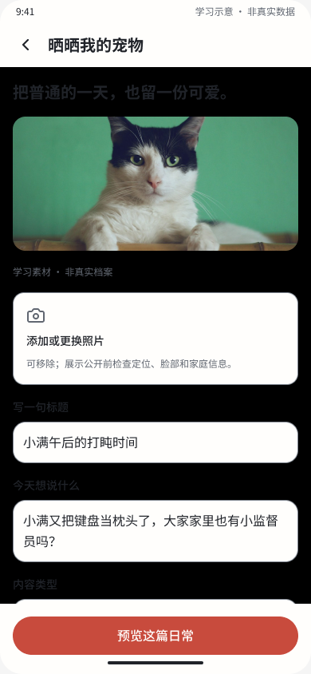

### 3. 自己的宠物 — 未通过：管理与状态链缺失

现有页面只有固定小满资料、照护字段与添加其他物种文案；添加行实际跳到领养发布基本资料。没有独立多宠切换、日记、受众或走失入口。对应 F05。

截图 04 · [Figma 当前画板](https://www.figma.com/design/3OFOC3vu18Kx9sRPjummOC/MND?node-id=56-74)

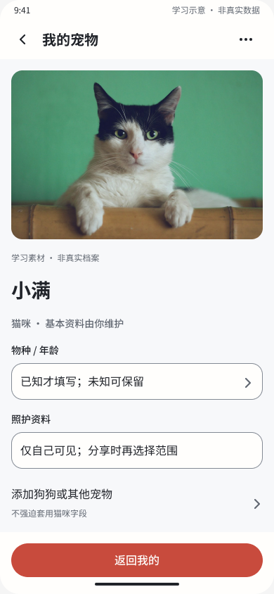

### 4. 领养阅读、申请与共享确认 — 部分具备：信任披露较清楚，内容维护未齐

清楚说明费用、来源与未知健康项；申请只共享必要摘要、允许取消是优点。条件阅读入口却直达申请表，且缺持续介绍、照护者更新照片和本宠物讨论。对应 F06/F10。

截图 05 · [Figma 当前画板](https://www.figma.com/design/3OFOC3vu18Kx9sRPjummOC/MND?node-id=56-37)

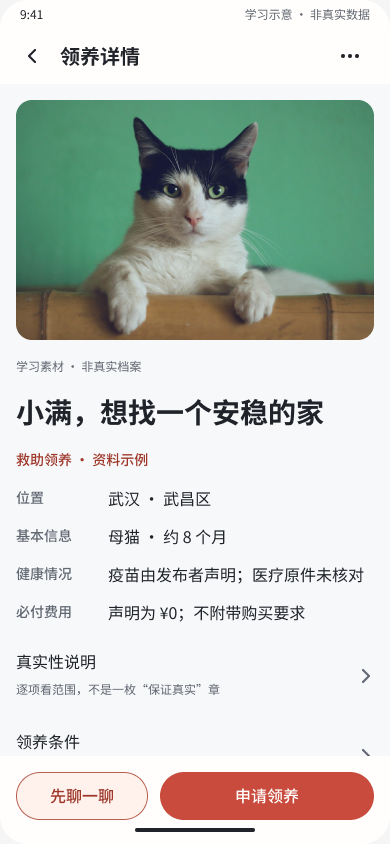

截图 19 · [Figma 当前画板](https://www.figma.com/design/3OFOC3vu18Kx9sRPjummOC/MND?node-id=56-39)

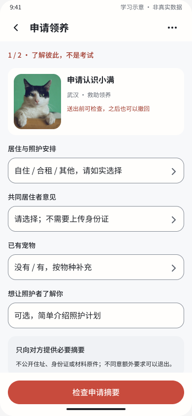

截图 06 · [Figma 当前画板](https://www.figma.com/design/3OFOC3vu18Kx9sRPjummOC/MND?node-id=56-40)

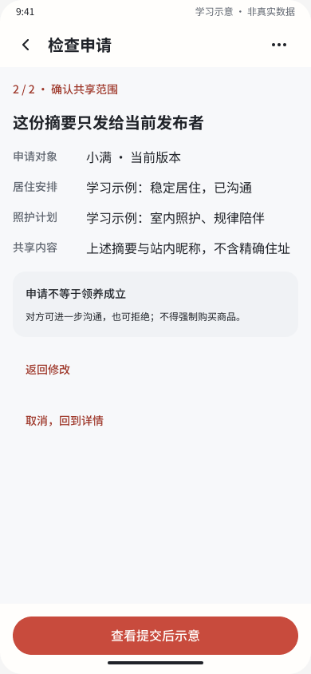

### 5. 互助地图 — 未通过：只有空态，无正常地图体验

不伪造精确位置、说明事件点非实时追踪是优点；但空态不能验收点位、区域、筛选、地图与案例卡联动。附近订阅5–100km及权限设置不在当前原生稿。对应 F07。

截图 07 · [Figma 当前画板](https://www.figma.com/design/3OFOC3vu18Kx9sRPjummOC/MND?node-id=56-55)

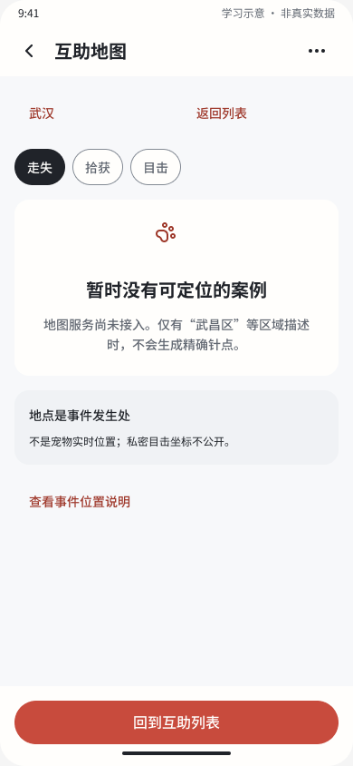

### 6. 走失维护、私密线索与收尾 — 未通过：错误上下文，找回闭环缺失

线索表单正确说明私密分享与不自动覆盖原位置。维护页查看线索却进入领养A1会话；找回和暂停都到通用不可用页，目的地还提供其他领养入口，缺本事件收尾。对应 F02/F03。

截图 08 · [Figma 当前画板](https://www.figma.com/design/3OFOC3vu18Kx9sRPjummOC/MND?node-id=56-60)

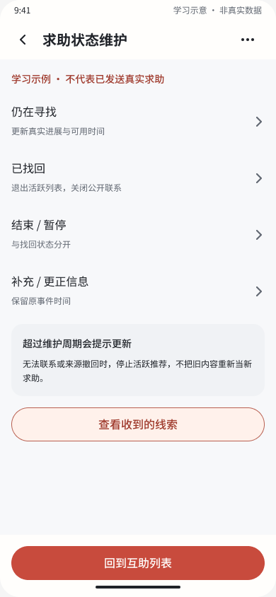

截图 09 · [Figma 当前画板](https://www.figma.com/design/3OFOC3vu18Kx9sRPjummOC/MND?node-id=56-57)

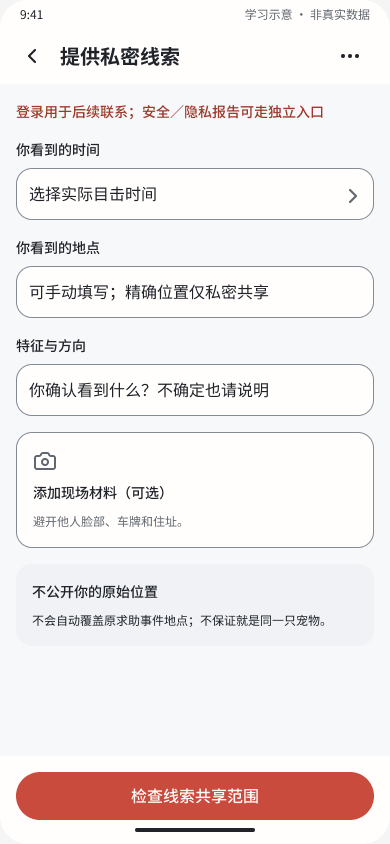

截图 16 · [Figma 当前画板](https://www.figma.com/design/3OFOC3vu18Kx9sRPjummOC/MND?node-id=56-62)

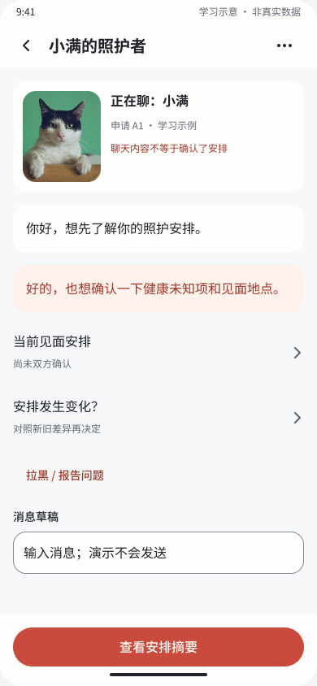

截图 17 · [Figma 当前画板](https://www.figma.com/design/3OFOC3vu18Kx9sRPjummOC/MND?node-id=56-83)

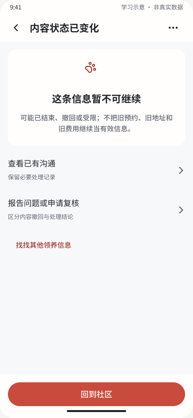

### 7. 站内私聊与群聊 — 部分具备：基础交流可评审，表达能力未齐

普通社交与领养咨询的标题上下文有所区分，群公告提醒隐私。两类输入栏均只有相机，没有表情面板；当前输入和发送为固定状态跳转，不是手机键盘及真实编辑验收。对应 F08。

截图 10 · [Figma 当前画板](https://www.figma.com/design/3OFOC3vu18Kx9sRPjummOC/MND?node-id=106-1409)

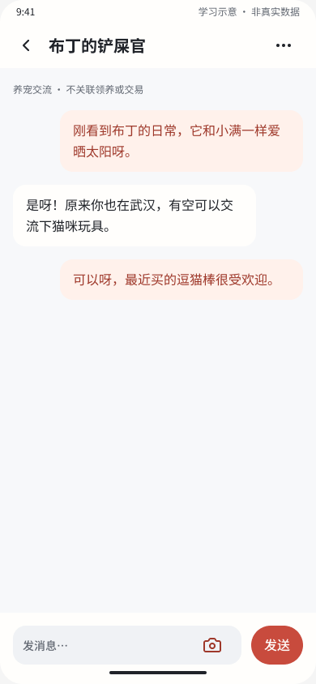

截图 11 · [Figma 当前画板](https://www.figma.com/design/3OFOC3vu18Kx9sRPjummOC/MND?node-id=106-1439)

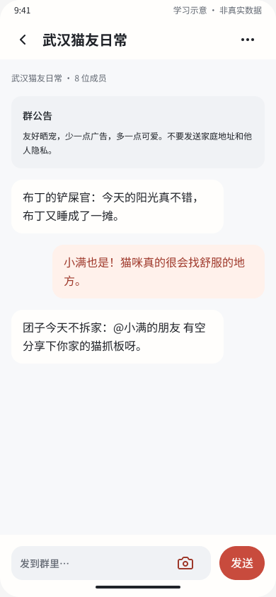

### 8. 登录与隐私 — 部分具备：告知清楚，权限和恢复路径待验证

游客浏览、协议默认不勾选、手机号不等于宠物认证，均表述清楚。但当前是验证码示意步骤和隐私说明，不是完整权限管理；附近订阅未落地，登录后返回原任务、同意阻断与撤回需补原型验证。对应 F07 及验证缺口 V01/V02。

截图 12 · [Figma 当前画板](https://www.figma.com/design/3OFOC3vu18Kx9sRPjummOC/MND?node-id=56-70)

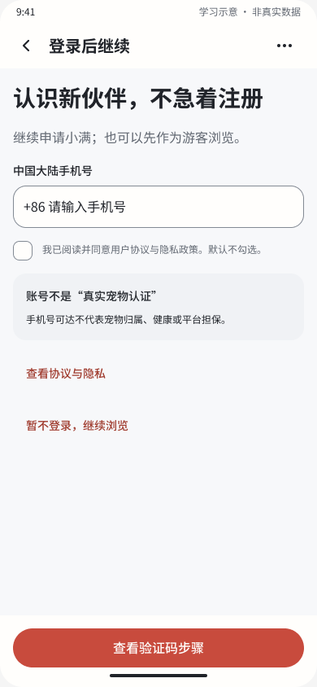

截图 13 · [Figma 当前画板](https://www.figma.com/design/3OFOC3vu18Kx9sRPjummOC/MND?node-id=56-76)

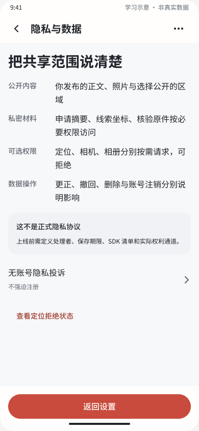

### 9. 举报、复核与断网 — 部分具备：有保护原则，状态仍为静态示例

把收到、人工查看、必要保护与结论分开，且不以举报数量当事实；断网页也明确保留草稿与阅读位置的设计意图。当前这些是示例，不证明已实现草稿保留、错误恢复或真实复核。对应验证缺口 V01/V02。

截图 14 · [Figma 当前画板](https://www.figma.com/design/3OFOC3vu18Kx9sRPjummOC/MND?node-id=56-67)

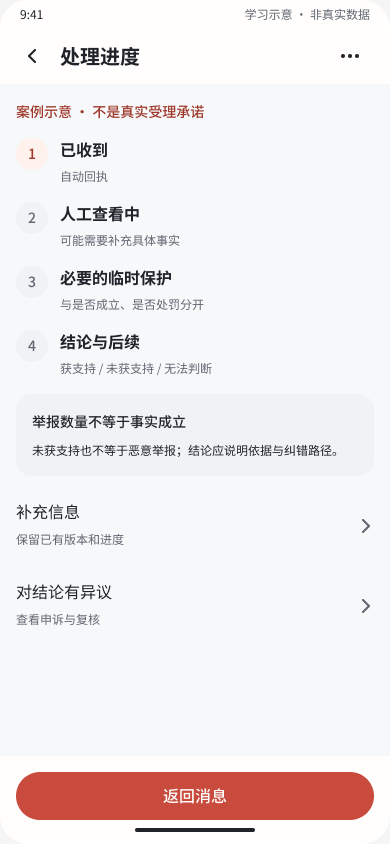

截图 15 · [Figma 当前画板](https://www.figma.com/design/3OFOC3vu18Kx9sRPjummOC/MND?node-id=56-81)

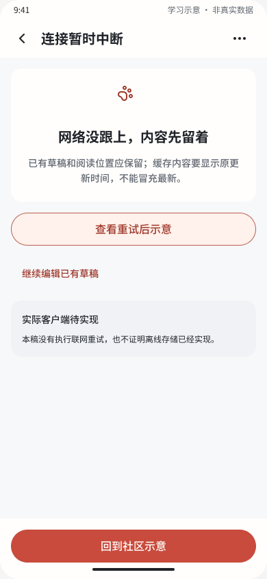

## 完整度与范围判定

| 用户要求 | 当前原生稿结论 | 下一步交付应是什么 |
|---|---|---|
| 晒宠、评论点赞、举报 | 有基础页及状态；黑底和回复对象需修 | 正确上下文、可返回的完整主线和异常 |
| 站内私聊、群聊 | 有基础交流与管理状态 | 统一表情、正确输入状态和真实设备走查 |
| 宠友圈 | 当前主版本未找到对应入口和状态 | 好友、时间流、发布、范围、互动及权限收紧 |
| 一人多宠、一宠独立日记与隐私 | 仅有固定宠物资料参考页 | 独立管理、日记、资料/单条受众与多宠上下文 |
| 领养宠物持续介绍、评论、照护者补图 | 当前详情是静态信息＋申请 | 持续更新与照片、角色、评论及编辑记录 |
| 自己宠物标记走失与联动 | 未在个人宠物页连接；旧维护存在错流 | 同宠物/同事件的发布、线索、找回与结束闭环 |
| 可开关的5–100km附近提醒 | 当前主版本未找到相应设置与状态 | 主动订阅、中心、半径、权限、频率及关闭 |
| 统一表情与表态 | 当前评论/私信/群输入栏未发现入口 | 同一面板与规则，不同承载面一致 |
| 视频 | 用户明确延期，不算缺项 | 本轮保持图文 |
| Pad、桌面、Web、暗色扩展 | 用户要求先完整普通手机，本轮不据此扣分 | 手机基线通过后再扩端 |

“未找到”限定于本轮检查的手机页 56:25、134 根原生状态、全部正文文本及关键控件去向；不宣称已审查其他历史页、未发布草稿或整个云端文件库。关键词缺失只是辅助线索，结论同时结合页面清单、完整当前正文和跳转结构。

## 无障碍与真实体验尚未验证

- **V01 实际操作**：本轮没有在手机逐条点击、调起键盘、输入真实文本或提交；只验证静态画面和原型动作。输入看似有字段、发送看似有按钮，不证明可编辑和错误恢复完整。
- **V02 可访问性**：未做读屏语义/顺序、键盘焦点、系统大字体、缩放/重排、减少动态、真实触控与辅助设备测试。静态截图不能证明完整 WCAG 合规。
- **V03 颜色**：黑底上的深色文案已可见地不可读。除这项明确失败外，本轮未逐个文本与真实复合背景计算完整对比度，不能沿用旧报告的颜色通过结论。
- **V04 权限和同步**：未验证修改受众后的详情/原图/通知是否撤销权限，或找回后是否停止排队提醒。它们是必要状态设计及后续实现验收项，不能由一张说明卡代替。
- **V05 场景压力**：长昵称、长回复、多宠物、多图、超大字体、无好友、权限拒绝、内容被删/撤回、慢网、异常时保存/返回和重复提交仍需逐条原型及设备走查。已有部分异常参考页，不等于全部缺失，也不等于通过。

## 建议修订顺序与开发门槛

1. 先修 F01–F03：六屏背景、私密线索去向、找回与其他结束。原 ID/导航保留，修正错误语义，不推翻整套视觉。
2. 补 F04–F08 的核心缺项：宠友圈、多宠日记与受众、领养更新与照护补图、附近提醒与地图、共享表情。
3. 修 F09/F10 的回复上下文和条件阅读；逐条明确每个按钮“是谁、哪只宠物、哪次事件、读还是提交”。
4. 为每条核心路径补正常、空、加载、失败、取消、权限拒绝和结果状态；输入/确认不能用无关示例页代替。
5. 重新导出关键画面、只读核对原型语义，再用真实手机走查、键盘/读屏和大字体验证。通过并由用户确认后，才完善应用代码。

本次仅保存审计截图和报告；没有改 Figma 画板、设计 Token、共享权限或应用代码，没有构建/编译/运行应用、真实发布、推送、定位、举报或联系他人。

