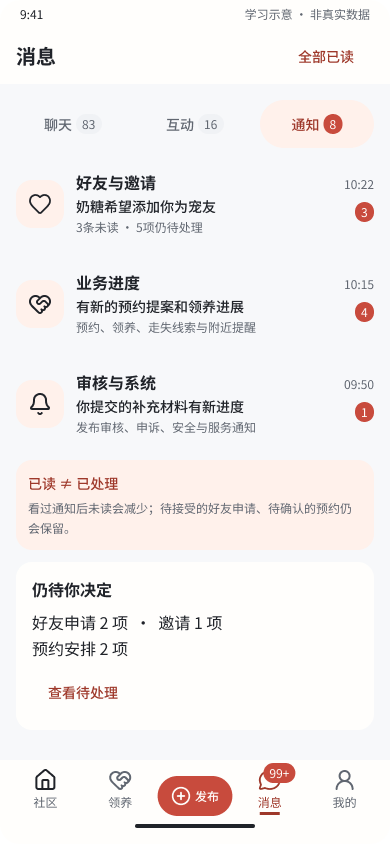
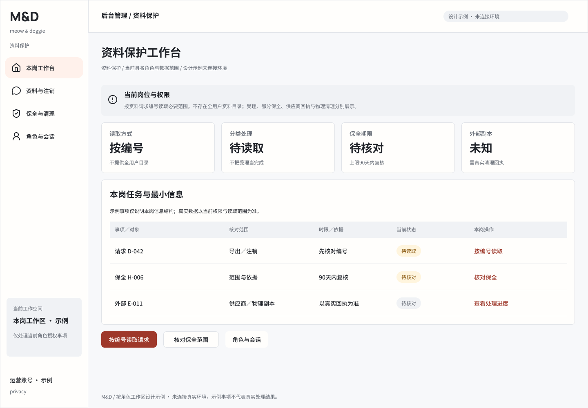
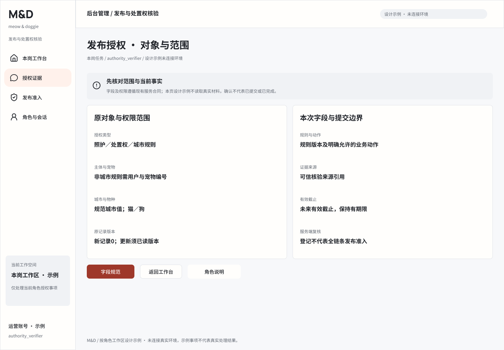
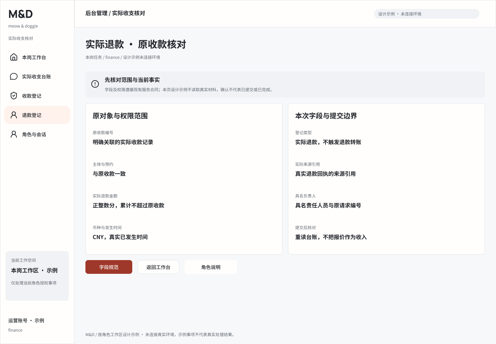
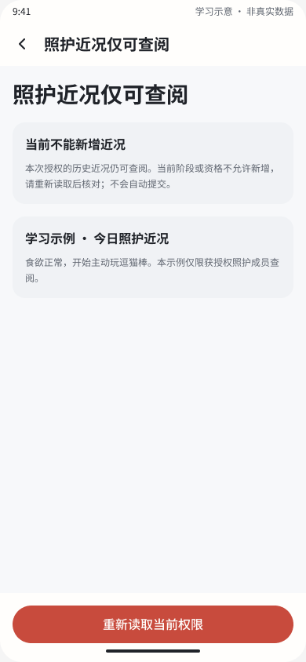
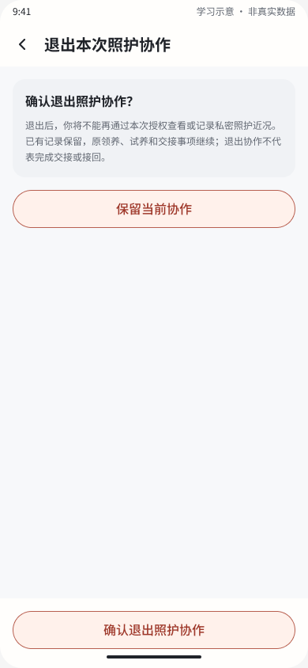
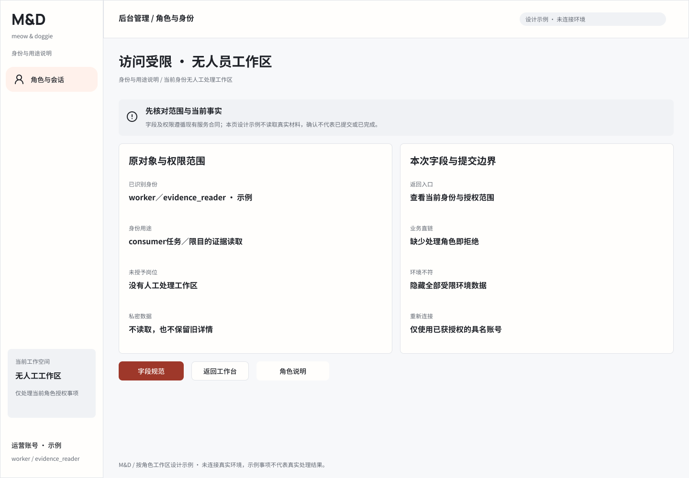
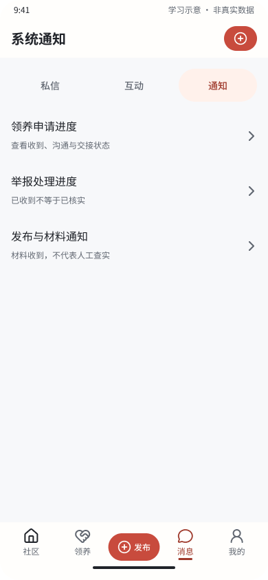
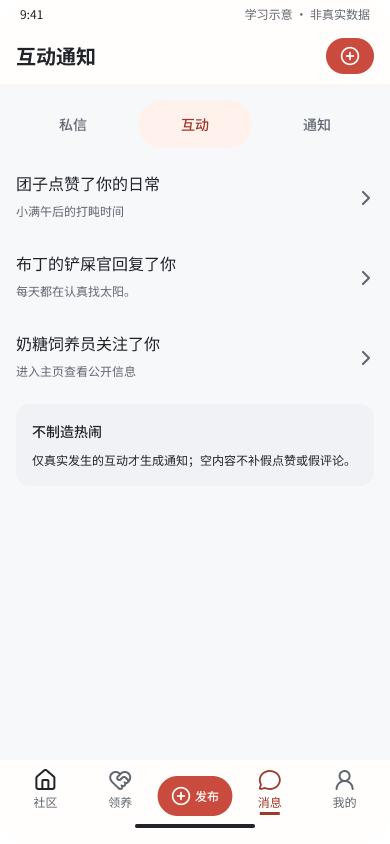

# M&D Figma与相关文档完整性复审

日期：2026-10-28（Asia/Shanghai）。任务：AI-20261028-FIGMA-REVIEW。工作树基线：main / b269504ad0cd0e179d8108fe60b9073ab97e9c99。

结论：仍有需要完善的地方，优先处理消息分类冲突、资料保护导航与后台任务交互细化，再补设计追踪和文档中心增量。已存在的协作新稿应登记复用。当前证据不支持重做视觉系统或宣称全量设计／产品已完成。

本轮仅新增此报告、当轮截图／证据和自身AI跟踪，未修改远端Figma、规范正文或业务源码。

## 范围与证据

- [原设计文件](https://www.figma.com/design/3OFOC3vu18Kx9sRPjummOC)：MCP回读当前12页，查看后台角色18根结构；抽查资料保护、授权、退款、无人员角色、消息及协作新稿。
- [文档中心](https://www.figma.com/design/JiFXEy785BcGEvaFBSswJ3)：读取页面目录，结合本地来源清单核查增量；本轮没有重新回读所有原生Specs全文。
- 本地产品／UX、全局未读、后台角色、跨端实施与验收、740状态追踪和源码引用；两项只读子任务辅助核对。
- [本轮证据清单](evidence.json)记录稳定节点、9张原始PNG与边界。截图均在本轮下载并实际打开；不用旧截图作为本轮视觉证据。

可确认的基础：默认浅色、M&D品牌、按角色工作区与“设计示例”标识一致；无人员角色页没有混合业务队列；未读与待办已在画板上区分；协作只读和退出稿已存在。下列建议沿用现有组件和视觉。

## 1. P2：好友申请在设计／专项合同与实现中归类不同

**证据：** [未读专项合同第25行](../../../MND_GLOBAL_UNREAD_SPEC.md#分类覆盖)把好友请求放在“通知：关系与邀请”；本轮[通知稿356:246](https://www.figma.com/design/3OFOC3vu18Kx9sRPjummOC?node-id=356-246)同样在“通知”Tab显示“好友与邀请”。但[UX-16](../../../../bmad/ux-design.md#ux-16三分类消息中心99-全局未读快照已读与表情贴纸面板)第196行把好友申请放在互动提醒；internal/mobile/social.go第208行实际发送 interactions。

**影响：** Tab角标、筛选、通知点击定位和待办入口可能与设计不同。设计文案调整不能代替事件归类的统一。

**建议：** 确定一份现行“事件→分类→去重键→已读／待办→跳转”表，再同步UX、专项合同、服务端事件与各端稿。对新请求／接受更新分别定义，不默认所有关系事件必须相同。仍保留“查看不等于接受”的边界。

## 2. P2：资料保护侧栏多出未定义独立路由的入口

**证据：** 本轮[资料保护工作台888:1542](https://www.figma.com/design/3OFOC3vu18Kx9sRPjummOC?node-id=888-1542)的侧栏有“保全与清理”，文本节点I889:1194;296:7。原[节点清单](../../admin-roles-2026-10-28/nodes-and-validation.json)第32行也记录此项；但[详细规范](../../../ADMIN_ROLE_WORKSPACES_2026_10_28.md#3-工作区入口和导航)第38行仅列本岗工作台、资料与注销、角色与会话，web-client/src/operator/roleWorkspaces.ts第22行只有dashboard、privacy任务路由。

**影响：** 设计到实现时无法明确该项是独立列表、资料请求内操作，还是重复跳到同一详情。保全动作本身已有规范，不能因此判断功能完全没有实现。

**建议：** 若它属于资料详情内动作，收敛侧栏并保留任务内入口；若确需独立入口，补路由、请求编号前置条件、可读范围、空态与权限要求。先统一设计／规范／代码三者，不直接创造全用户资料目录。

## 3. P2建议：把后台关键任务从字段说明细化为操作流程

**证据：** 本轮[授权稿890:2764](https://www.figma.com/design/3OFOC3vu18Kx9sRPjummOC?node-id=890-2764)、[退款稿890:3089](https://www.figma.com/design/3OFOC3vu18Kx9sRPjummOC?node-id=890-3089)主要是“原对象与权限范围／本次字段与提交边界”说明卡，主动作是“字段规范”。[详细规范第5–6节](../../../ADMIN_ROLE_WORKSPACES_2026_10_28.md#5-任务页字段确认与回读)已要求实际填写、确认、版本冲突和未知恢复；[源码交付](../../../../client/ADMIN_ROLE_WORKSPACES_2026_10_28.md)第18行已说明RoleTasks有字段与预览确认。

**性质：** 这是设计细化建议；不是接口缺失、源码未写或旧后台确认稿不存在的结论。

**建议：** 优先完善年龄、授权、收款／退款的可编辑表单、字段错误、完整确认、实际响应／失败／结果未知、失权与版本变更。先复用原业务13稿、运维14稿及现有通用状态，再补每岗不同字段、权限和回读目标的明确映射。没有独立回执的合同继续提供人工回源核对，不画“自动成功”或支付转账。

## 4. P2：协作新稿已存在，但本地来源和实现追踪落后

**证据：** MCP发现“协作退出与有限授权 · 2026-10-28”分组：[手机910:357845](https://www.figma.com/design/3OFOC3vu18Kx9sRPjummOC?node-id=910-357845)、[Web915:386337](https://www.figma.com/design/3OFOC3vu18Kx9sRPjummOC?node-id=915-386337)。两处各8状态，包含照护／介绍协作退出确认与已退出、照护工作区、只读、不可用和介绍维护。本轮已打开退出确认与只读稿。

本次新增审查文件之前，本地docs和scripts无两个分组ID或分组名。现行[740状态追踪](../../../../client/figma-implementation-trace-2026-10-24.json)第17778行仍将publisherCollabActive等原生入口指向CarePages.kt、Web统一指向/adoptions；实际邀请动作在kmp/clientUi/.../SocialPages.kt第158行，受限照护入口在web-client/src/App.tsx第484行，为/care-collaboration/{id}。[业务检查点](../../../../client/BUSINESS_COLLABORATION_2026_10_28.md)也已记载这些新行为。

**建议：** 登记8个状态的稳定ID、原型目标、各端来源、路由和替代关系，纠正SocialPages／CareCollaboration归属，注明剩余布局与运行验证边界。不要为了补本地台账重复造稿，也不要未经逐端核对直接把740改成“全部新增覆盖”。本轮仅验证手机／Web新分组；其余布局未全量检查。

## 5. P2：文档中心需做10月28日增量核对和同步

**证据：** [同步说明](../../../../figma-sync/README.md#2026-10-28后续增量边界)已明确旧manifest是10月27日189份文本快照；角色规范21:2与交付说明22:2已单独写入，不能把它们当作缺失。按本次读取的SHA比较，旧清单中12个本地文件已变化：README、API_CATALOG、CURRENT_BASELINE、DOCUMENTATION_CATALOG、PRODUCT_AND_DELIVERY_MATRIX、docs/README、AI三份状态／日志、client/README、设计交接索引和figma-sync/README。AI状态／日志是持续变化来源，不能把本轮跟踪追加本身算成另一项产品缺陷。

**影响：** 在Figma中心阅读的人可能沿旧API速查和旧交付状态继续工作。当前本地已诚实声明快照边界，问题是仍需完成增量闭环，不能称其虚假同步。

**建议：** 生成变更／新增／已单独同步的增量表，重点核对现行基线、API、邀请协作和设计索引；实际写入后分页回读，并记录新节点／摘要。保留旧manifest作为历史快照。由于本轮未重新回读Specs全文，不能断言12份远端正文逐一仍旧，后续应先比对远端再更新。

## 6. P3：就地清理仍会误导接手的旧规范句与待办

- docs/ai/TASKS.md第91–93行处于“部分完成、受阻与待办”现行区，仍称Web新TS／Desktop未迁移；当前基线与client/README第25行已说明Web独立DOM、Android／iOS／Desktop公共clientUi。应写“源码已接，逐端功能／运行验收未完成”，保留真实余量。
- docs/client/DESIGN_AND_ACCEPTANCE.md第62行、client/README第79行仍直接禁止共享业务Composable。IMPLEMENTATION_PLAN第5行已有最新方案替代说明，不能把整份计划判错；建议在旧句旁明确“已被公共clientUi方案替代”，区分共享页面与各宿主独立窗口／Insets／输入／返回／系统桥接。
- MND_FIGMA_DESIGN_DOCUMENT的“当前页面位置”主体仍展示10月22日9页目录，上方补充两后台页面，最新角色页另在开头说明；本轮实际为12页。建议汇成一份当前目录，将9页表保留为带日期历史，降低来回拼接成本。

## 建议顺序与验收边界

先统一第1、2项业务含义，再细化第3项关键任务稿；第4–6项作为同批追踪与文档增量维护。每项都记录设计、文档、源码和运行四层状态。

已有320宽、160%大字、200%网页缩放、VoiceOver、键盘与焦点恢复等验收要求，本轮不把它们列为“缺少无障碍规范”。仍需后续逐端运行证据，可在追踪表补Android手机／平板、iPhone／iPad、Web、Desktop各自的视觉／输入／读屏／网络恢复证据、日期与责任人。

本轮未播放原型，未运行编译、构建、Gradle、Go build/run/test、test、lint、类型检查、应用、迁移、部署或CI；遵循用户与仓库默认禁止运行规则。抽样截图不证明完整交互可达、无障碍合规或全量功能完成。

## 附：其他本轮截图

